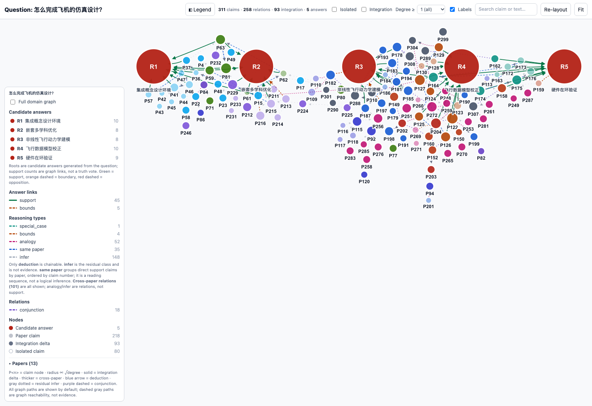
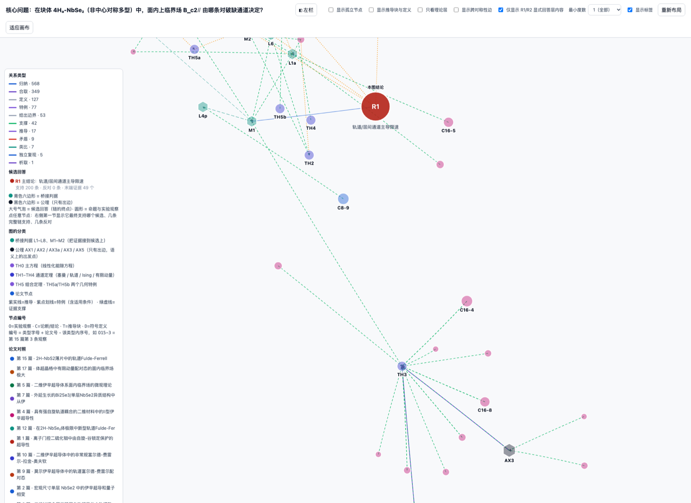

# Ariadne

**问题驱动的领域推理图。**

[English](README.md) · [示例](#示例) · [快速开始](#快速开始) · [配置](#配置) · [命令](#命令)



Ariadne 把领域问题变成一张可检查的图：论文、claim、候选答案、推理链都在图
上。它不直接给一段聊天式答案，而是给出：

- 从问题生成的**候选答案**（root，R1–R5）；
- 支持、限定或反驳每个答案的 **claim 与证据**；
- claim 之间的**类型化关系**，包括跨论文关系；
- 到达每个 root 的**全部多步推理链**（Markdown + Mermaid）。

名字取自 Ariadne 的线团：在迷宫里靠它找路。这里“线”就是答案层和通向答案的
推理路径。

```text
问题
  -> LKM 查询规划 + 多查询检索 + 图探测选论文
  -> paper2ir      (论文图 -> claims_final)
  -> single-paper  (claims -> Gaia IR package)
  -> merge         (多篇 package -> 领域图)
  -> Step 6        (候选答案 root + 类型化链接 + 推理链)
  -> HTML 问题图 + 全部链条 Markdown
```

Ariadne 是维护中的 Gaia IR 三套 pipeline 之上的**薄产品层**：不复制、不改写
pipeline 内部实现，只负责编排、隔离每次运行，并补上问题驱动的答案层和交付物。

## 下载

不用 clone，直接下载自包含安装包：

[ariadne-0.4.0-bundle.tar.gz](https://github.com/CatherineWuleyan/gaia-ir/releases/download/v0.4.0/ariadne-0.4.0-bundle.tar.gz) ·
[ariadne-0.4.0-bundle.zip](https://github.com/CatherineWuleyan/gaia-ir/releases/download/v0.4.0/ariadne-0.4.0-bundle.zip) ·
[SHA256SUMS](https://github.com/CatherineWuleyan/gaia-ir/releases/download/v0.4.0/SHA256SUMS)

包内含 Ariadne、三套 pipeline、离线飞机示例和 `install.sh`。自己构建：

```bash
./packaging/build_release.sh
```

## 示例

### 1. 怎么完成飞机的仿真设计？

> **问题：** 怎么完成飞机的仿真设计？
> **领域：** 概念设计、飞行动力学、气动建模、MDO、硬件在环验证。


冻结的飞机图包含 **13 篇论文、311 条 claim、258 条关系、93 条 integration
delta、5 个候选答案**；链条导出器产出 **107 条多步链**。

| Root | 候选答案 | 链条数 |
| --- | --- | ---: |
| R1 | 集成概念设计环境 | 20 |
| R2 | 嵌套多学科优化 | 26 |
| R3 | 非线性飞行动力学建模 | 25 |
| R4 | 飞行数据模型校正 | 21 |
| R5 | 硬件在环验证 | 15 |

看图时重点看：

- 五个红色大 root，以及绿色 **support** 链接；
- **same-paper** 是按论文和 claim 编号排列的阅读顺序，不是逻辑证明；
- 虚线 **analogy** / **infer** 是可见的上下文，但**不会**被升级成 deduction，
  也不构成 support chain。

交付物：

- [飞机问题图 viewer](../outputs/question_domain_aircraft/domain_viewer_question.html)
- [指向 R1–R5 的全部链条](../outputs/question_domain_aircraft/ALL_CHAINS_TO_ROOTS.md)
- [答案层 JSON](../outputs/question_domain_aircraft/answer_layer.json)
- [冻结 demo 数据](../outputs/question_domain_aircraft/)

离线运行（不需要 key，不调用 LKM）：

```bash
./ariadne/run.sh demo
```

### 2. 4H_a-NbSe2 的面内 B_c2 由哪条对破缺通道决定？

> **问题：** 在块体 4H_a-NbSe2（非中心对称多型）中，面内上临界场
> B_c2∥ 由哪条对破缺通道决定：塞曼（经 Ising SOC 抬高）还是轨道
>（含有限动量/FFLO）？



复核版 Physics 图包含 **18 篇论文、500 条 claim、654 个节点、1298 条边、
14 个理论层节点**。这个例子说明答案层必须把两个“兼容但竞争”的解释分开：

- **R1**：Ising 保护压制塞曼通道，由轨道/层间通道决定主要量级；
- **R2**：若 γ ≈ 31/5.5 ≈ 5.6，纯轨道通道在数值上可以自足；
- 真正未决的是 Ising SOC 是否**必要**，而不是它是否存在。

Physics 例子也展示了产品的诚实边界：图里有 9 条矛盾边，包含跨对称性、
跨材料的证据。viewer 会显示它们，但不会悄悄改写成 support。

交付物：

- [Physics 复核版 viewer](../outputs/physics_domain/reviewed/domain_graph_full.reviewed.html)
- [答案层 JSON](../outputs/physics_domain/reviewed/answer_layer.reviewed.json)
- [Mentor 复核记录](../outputs/physics_domain/reviewed/MENTOR_REVIEW.md)
- [目标问题](../outputs/physics_domain/target_question.json)

GitHub 会把 HTML 当源码显示。克隆后用浏览器打开，或在仓库根目录运行
`python3 -m http.server` 再访问。

## 快速开始

### 环境要求

| 依赖 | 用途 |
| --- | --- |
| Python **3.11+** | harness 和 pipeline 代码 |
| `gaia-lang==0.5.0a7` | single 阶段使用的 Gaia IR 编译器 |
| `bohr` CLI **2.2+** | 实时 LKM 检索、论文图、可选 PDF 解析 |
| DeepSeek 或 OpenAI-compatible API key | paper2ir、single、merge、Step 6 |
| Bohrium 账户 + access key | 实时 LKM 调用（`demo` 不需要） |

公开仓库已经包含 Ariadne 需要的 pipeline 代码：
`pipelines/clean_claims`、`pipelines/single_paper`、`pipelines/merge` 和
`weekly_reports/export_single_artifacts.py`。

### 1. Clone 并安装

```bash
git clone https://github.com/CatherineWuleyan/gaia-ir.git
cd gaia-ir

python3 -m venv .venv
source .venv/bin/activate          # Windows: .venv\Scripts\activate

pip install --pre -r ariadne/requirements.txt
pip install -e agent
```

`run.sh` 按以下顺序选择解释器：`$ARIADNE_PYTHON`、`.venv-gaia-a7`、`.venv`、
`python3`。也可以把解释器写进配置（见下文）。

### 2. 安装 Bohr CLI

```bash
npm install -g bohr-cli
bohr version
```

如果本机已经登录 `bohr`，Ariadne 可以直接用当前 active profile。想给 Ariadne
单独一个 profile，用下一步的 `ariadne auth bohr`。

### 3. 配置 API key 和 Bohr 账户

交互式（推荐）：

```bash
./ariadne/run.sh config init
```

非交互式：

```bash
export DEEPSEEK_API_KEY="sk-..."
export BOHR_ACCESS_KEY="..."

./ariadne/run.sh config init --no-input \
  --api-key "$DEEPSEEK_API_KEY" \
  --bohr-access-key "$BOHR_ACCESS_KEY"
```

配置写到 `~/.config/ariadne/config.json`，权限 `0600`。Ariadne 不会打印 key；
`config show` 和 `config get` 都会打码。

然后登录 Bohr：

```bash
./ariadne/run.sh auth bohr
```

它创建/更新 Bohr profile `ariadne`，不改你原来的 default profile。想用浏览器
或 device flow：

```bash
./ariadne/run.sh auth bohr --device
```

最后检查：

```bash
./ariadne/run.sh doctor
```

`doctor` 会报告配置来源、模型 endpoint、Bohr 登录、pipeline 文件，以及
demo / 离线 full / 实时 LKM full 是否就绪，不会输出 secret。

### 4. 跑离线 demo

```bash
./ariadne/run.sh demo
```

在冻结的飞机图上只跑问题层：不调用 LKM，也不调用 LLM。输出在
`outputs/ariadne_runs/`：

```text
outputs/ariadne_runs/run_<timestamp>_<question>/
  domain_viewer_question.html   # 自包含的问题图
  ALL_CHAINS_TO_ROOTS.md        # 每个 root 的全部多步链
  run.json                      # 问题、阶段耗时、运行时摘要
  04_question/                  # answer_layer.json、view model、evaluation
```

打开 viewer：

```bash
open outputs/ariadne_runs/run_*/domain_viewer_question.html      # macOS
xdg-open outputs/ariadne_runs/run_*/domain_viewer_question.html  # Linux
```

### 5. 跑实时问题

先用**两篇论文**检查质量和成本：

```bash
./ariadne/run.sh ask "怎么完成飞机的仿真设计？" --top-k 2 --yes
```

现在 Ariadne 会自己选论文：LLM 查询规划器把问题扩成多条 LKM 查询，候选论文
去重排序后逐个探测论文图；空图、没有 conclusion 的图和过薄的图会被跳过，然后
才进入 paper2ir。完整审计写在 `01_retrieval/selection.json`。

不花钱先看计划：

```bash
./ariadne/run.sh ask "怎么完成飞机的仿真设计？" --top-k 2 --dry-run
```

说明：

- `--yes` 授权本次运行的计费 LKM 调用。不传时，交互终端会询问；批处理环境
  会直接失败，不会挂住。
- `--top-k 2` 控制 paper2ir 的成本和延迟。每篇论文 paper2ir 有 **14 个 LLM
  步骤**，之后 single 和 merge 还会调模型。
- `--no-fulltext` 跳过 arXiv PDF 下载/解析，改用图派生文本。
- `--no-query-planner` 只用确定性 fallback 查询。
- `--queries N` / `--candidate-limit N` 调整检索宽度和图探测数量。
- `--papers papers.json` 用本地 spec 替代自动检索（见
  [离线论文 spec](#离线论文-spec)）。

## 自动检索

full 模式不需要你手动选论文。检索阶段是：

1. **查询规划**：让模型把问题扩成多条简短英文 LKM 查询，覆盖核心概念、
   方法/系统、评估场景；英文问题和确定性关键词查询始终作为 fallback 保留。
2. **多查询检索**：最多执行 `retrieval.queries` 次 hybrid LKM 搜索
   （`conclusion,abstract` scope），按 LKM id 合并论文。
3. **候选排序**：综合命中查询数、LKM rerank 分数、轻量词面相关性和
   （探测后的）图规模排序。
4. **图探测**：逐篇取论文图；空图、没有 conclusion 节点的图、过薄的图直接
   跳过。第一轮不够 `min_papers` 时会继续扩展探测，而不是整次失败。
5. **补建缺失图**：论文没有原生 LKM 图、但有 arXiv/DOI PDF 时，可以用
   `bohr lkm extract` 建图（`--format graph`）。每次成功 1.00 CNY（缓存命中
   0.10 CNY），由 `retrieval.max_extractions` 限制（默认 3），
   `--no-lkm-extract` 可关闭。
6. **选择与审计**：选出有图且相关的论文，并继续用其余候选补足 `--top-k`；
   把每条查询、候选、探测结果、跳过原因、相关性分数、提取任务和最终选择
   写入 `01_retrieval/selection.json`。

这条路径专门处理 LKM 的真实情况：很多论文被索引了，但没有可抽取的知识图。
`--papers ...` 仍会完全绕过自动检索，适合你已经知道语料的情况。

调参：

```bash
./ariadne/run.sh ask "..." --queries 5 --candidate-limit 16
./ariadne/run.sh ask "..." --no-query-planner   # 只用确定性查询
./ariadne/run.sh config set retrieval.min_relevance 0.2
```

如果选出来的论文不对，先看 `selection.json`：`queries.json` 是查询计划，
`candidates.json` 是排序后的候选池，`search_raw_*.json` 是每次 LKM 原始响应，
`extract/*/submit.json` 和 `result.json` 是补建图的审计。选择会尽量补足
`--top-k`；相关性只是偏好，不是硬上限。

## 配置

### 文件位置与优先级

| 优先级 | 来源 |
| ---: | --- |
| 1 | CLI flags（`--api-key`、`--base-url`、`--model`、`--bohr-profile` 等） |
| 2 | 环境变量 |
| 3 | Ariadne 配置文件 |
| 4 | `agent/.env`（旧版，本地） |
| 5 | 内置默认值 |

配置文件按以下顺序解析：

```text
$ARIADNE_CONFIG
$XDG_CONFIG_HOME/ariadne/config.json
~/.config/ariadne/config.json
```

Windows 下如果设置了 `APPDATA`，使用 `%APPDATA%\ariadne\config.json`。

最小配置如下；完整示例见 [`config.example.json`](config.example.json)：

```json
{
  "version": 1,
  "model": {
    "provider": "deepseek",
    "api_key": "sk-...",
    "base_url": "https://api.deepseek.com/v1",
    "model": "deepseek-v4-flash",
    "merge_model": "deepseek-v4-flash"
  },
  "bohr": {
    "profile": "ariadne",
    "access_key": "...",
    "host": "https://open.bohrium.com",
    "auto_approve_spend": false,
    "payment_source": ""
  },
  "runtime": {
    "python": ""
  }
}
```

配置文件是**稀疏**的：只写你显式设置过的值。未设置的值走默认值，或继续向
环境变量 / `agent/.env` 回退。

### 配置命令

```bash
./ariadne/run.sh config path                 # 打印配置路径
./ariadne/run.sh config init                 # 交互式配置
./ariadne/run.sh config init --no-input ...  # 脚本化配置
./ariadne/run.sh config show                 # 生效配置，secret 打码
./ariadne/run.sh config show --json
./ariadne/run.sh config get model.model
./ariadne/run.sh config set model.model deepseek-v4-flash
./ariadne/run.sh config unset model.model
./ariadne/run.sh config test --api           # 发一次很小的 chat completion
./ariadne/run.sh config test --bohr          # bohr auth status
```

支持的 key：

| Key | 含义 |
| --- | --- |
| `model.provider` | `deepseek` 或 `openai-compatible` |
| `model.api_key` | 模型 key（输出会打码） |
| `model.base_url` | OpenAI-compatible base URL，默认 `https://api.deepseek.com/v1` |
| `model.model` | paper2ir / single 使用的模型 |
| `model.merge_model` | merge / Step 6 使用的模型 |
| `bohr.profile` | Bohr CLI profile；空表示 active profile |
| `bohr.access_key` | Bohrium access key（输出会打码） |
| `bohr.host` | 默认 `https://open.bohrium.com` |
| `bohr.auto_approve_spend` | true 时总是给计费 LKM 命令加 `--yes` |
| `bohr.payment_source` | 空（网关默认）、`photon` 或 `balance` |
| `runtime.python` | pipeline 子进程使用的 Python |
| `retrieval.use_query_planner` | 是否使用 LLM 查询规划器（默认 true） |
| `retrieval.queries` | 每个问题的最大 LKM 查询数（默认 5） |
| `retrieval.per_query` | 每条查询请求的结果数（默认 8） |
| `retrieval.candidate_limit` | 第一轮图探测数（默认 16，不够会扩展） |
| `retrieval.min_papers` | 至少需要几篇有图的论文（默认 2） |
| `retrieval.min_graph_nodes` | 低于该节点数的图视为过薄（默认 3） |
| `retrieval.min_relevance` | 优先论文的词面相关性门槛（默认 0.2） |
| `retrieval.use_lkm_extract` | 是否用 `bohr lkm extract` 补建缺失图（默认 true） |
| `retrieval.max_extractions` | 每次运行最多补建几篇（默认 3，0 关闭） |

### 环境变量

| 变量 | 用途 |
| --- | --- |
| `ARIADNE_CONFIG` | 配置文件路径 |
| `ARIADNE_MODEL_API_KEY` / `DEEPSEEK_API_KEY` / `OPENAI_API_KEY` | 模型 key |
| `ARIADNE_MODEL_BASE_URL` / `DEEPSEEK_BASE_URL` / `OPENAI_BASE_URL` | endpoint |
| `ARIADNE_MODEL` / `DEEPSEEK_MODEL` / `OPENAI_MODEL` | 模型名 |
| `ARIADNE_MERGE_MODEL` / `DEEPSEEK_MERGE_MODEL` | merge 模型 |
| `ARIADNE_BOHR_ACCESS_KEY` / `BOHR_ACCESS_KEY` / `LKM_ACCESS_KEY` | Bohr key |
| `ARIADNE_BOHR_PROFILE` | Bohr profile |
| `ARIADNE_AUTO_APPROVE_SPEND` | `1` / `true` 表示自动批准计费调用 |
| `ARIADNE_PAYMENT_SOURCE` | `photon` 或 `balance` |
| `ARIADNE_PYTHON` | Ariadne 及其子进程使用的解释器 |

环境变量优先于配置文件，所以 CI 可以完全不写配置文件：

```bash
DEEPSEEK_API_KEY=... BOHR_ACCESS_KEY=... \
  ./ariadne/run.sh ask "..." --top-k 2 --yes
```

### 模型兼容性

paper2ir、single、merge 使用 **OpenAI-compatible chat-completions** 客户端。
DeepSeek 是默认值，也是实际测试过的路径。只要 endpoint 支持
`POST {base_url}/chat/completions` 和
`Authorization: Bearer <key>`，就可以通过 `model.base_url`、`model.model`、
`model.merge_model` 接进来。

只设置 `ANTHROPIC_API_KEY` **不能**跑 full：single 和 merge 阶段需要
OpenAI-compatible 客户端。`doctor` 会明确提示这一点。

### Bohr 账户与计费

`bohr` 使用 profile。Ariadne 读 `bohr.profile`；为空时使用 active profile。
`ariadne auth bohr` 会创建专用 profile `ariadne`：

```bash
# access key（非交互）
./ariadne/run.sh auth bohr --access-key "$BOHR_ACCESS_KEY"

# 浏览器流程
./ariadne/run.sh auth bohr

# 无头机器 device flow
./ariadne/run.sh auth bohr --device

# 只检查
./ariadne/run.sh auth bohr --check
./ariadne/run.sh auth status
```

等价的 Bohr CLI 命令：

```bash
bohr auth login --ak "$BOHR_ACCESS_KEY" --ak-only --profile ariadne
```

LKM `search`、`graph`、`reasoning` 等调用按次计费（写作时 **0.05 CNY/次**，
个人每月 1,000 次免费额度）。PDF 解析单独计费。Ariadne 在第一次计费调用前
会询问；`--yes` 或 `bohr.auto_approve_spend=true` 表示授权本次运行。
`--dry-run` 不花钱。查询当前价格：

```bash
bohr billing pricing --resource lkm -o json
```

### Python 解释器

`run.sh` 在启动 Ariadne 之前就选好解释器；Ariadne 启动后，
`runtime.python` / `ARIADNE_PYTHON` 决定 pipeline 子进程用哪个 Python。
venv 不叫 `.venv` 时建议显式指定：

```bash
./ariadne/run.sh config set runtime.python /opt/venvs/gaia/bin/python
```

## 命令

| 命令 | 作用 |
| --- | --- |
| `ask "<question>"` | full：问题 → LKM → paper2ir → single → merge → render |
| `ask ... --mode demo` | 在冻结飞机图上跑答案层 |
| `ask ... --dry-run` | 预检并打印计划，不写文件、不花钱 |
| `ask ... --papers spec.json` | 用离线论文 spec 替代 LKM 检索 |
| `ask ... --top-k N` | 选出的论文数（先用 2） |
| `ask ... --queries N` | 自动检索的最大 LKM 查询数 |
| `ask ... --candidate-limit N` | 第一轮图探测的候选数 |
| `ask ... --no-query-planner` | 关闭 LLM 查询规划器，只用 fallback 查询 |
| `ask ... --no-lkm-extract` | 不用 `bohr lkm extract` 补建图 |
| `ask ... --max-extractions N` | 本次运行最多补建几篇 |
| `ask ... --yes` | 授权本次计费 LKM 调用 |
| `ask ... --no-fulltext` | 跳过 PDF 解析，改用图派生文本 |
| `demo` | 离线飞机示例 |
| `doctor` | 检查配置、Python、模型、Bohr、pipeline、就绪状态 |
| `config init/show/set/get/unset/path/test` | 管理配置 |
| `auth bohr/status` | Bohr 登录与认证状态 |

运行级 flags：

```text
--config PATH
--api-key KEY  --base-url URL  --model NAME  --merge-model NAME
--bohr-profile P  --bohr-access-key AK  --payment-source photon|balance
--python PATH
```

## 输出

每次 full / demo 运行都隔离在
`outputs/ariadne_runs/<timestamp>_<slug>/`：

| 文件 | 含义 |
| --- | --- |
| `domain_viewer_question.html` | 自包含问题图，无需服务器 |
| `ALL_CHAINS_TO_ROOTS.md` | 到达 R1–R5 的全部多步链，含 Mermaid 和内容表 |
| `05_outputs/answer_layer.json` | roots、links、类型化边、exploratory paths（full） |
| `05_outputs/domain_view_question.json` | 注入答案层后的 view model（full） |
| `run.json` | 问题、各阶段耗时、配置摘要（不含 secret）、输出路径 |
| `logs/` | 各阶段命令日志 |

离线 demo 的答案层和 view model 在 `04_question/`，不是 `05_outputs/`；两个
主交付物仍会复制到 run 根目录。

full 运行会保留中间阶段：

```text
01_retrieval/   queries.json、candidates.json、selection.json、
                search_raw_*.json、extract/<paper>/submit.json|result.json、
                每篇 graph.json + ocr.md
02_paper2ir/    run-local clean_claims 副本、每篇 claims_final.json
03_single/      Gaia IR package、formalization.json、knowledge.index.json
04_merge/       merge run、view_model.json
05_outputs/     答案层与交付物
```

`02_paper2ir/pipeline` 是每次运行单独复制的，所以不会复用旧数据，也不会让
上一次失败的 paper2ir 污染下一次运行。

## 工作原理

| 阶段 | 做什么 | 实现 |
| --- | --- | --- |
| `01_retrieval` | 规划多条 LKM 查询、合并排序候选、探测论文图、跳过空图/无 conclusion/过薄图，再取全文或用图派生文本 | [`ariadne/retrieval.py`](ariadne/retrieval.py) |
| `02_paper2ir` | 14 步 paper2ir：LKM 图 + 文本 → `claims_final.json` | [`pipelines/clean_claims`](../pipelines/clean_claims/)（run-local 副本） |
| `03_single` | 维护中的 single pipeline：claims → `gaia.ir.json`、`formalization.json`、`knowledge.index.json` | [`pipelines/single_paper`](../pipelines/single_paper/) + harness |
| `04_merge` | 把多篇 package 合成一张领域图，含 K conclusions 和 Step 6 答案 root/link | [`pipelines/merge/pipeline.question.json`](../pipelines/merge/pipeline.question.json) |
| `05_render` | 渲染问题 viewer、导出全部链条 | [`render_question_viewer.py`](../pipelines/merge/pipeline_merge_question/render_question_viewer.py)、[`export_chains_markdown.py`](../pipelines/merge/pipeline_merge_question/export_chains_markdown.py) |

Ariadne 封装的三套维护中 pipeline：

1. **paper2ir** — 论文 → claims；
2. **single** — claims → 单篇推理图；
3. **merge** — 多图 → 领域图 + 问题答案层。

检索在三套 pipeline 之前；渲染在之后。

### “support”到底是什么意思

- 只有 **deduction** 边可以成链。`infer`、`analogy`、`bounds`、
  `special_case`、`same-paper` 会保留为可见上下文，但不会被升级为 deduction。
- `same-paper` 是按论文和 claim 编号排列的直接支持 claim；它是阅读顺序，
  不是逻辑证明。
- viewer 默认显示全部图路径。能画出来不等于有证据；链条导出器会标出边类型。
- root 是**候选答案**，不是真值标签。这张图是证据与缺口的分布图，不是裁决。

## 离线论文 spec

`--papers` 跳过 LKM 检索。spec 可以指向 LKM id，也可以指向本地文件：

```json
{
  "papers": [
    {
      "lkm_id": "1234567890123456789",
      "title": "Paper title",
      "arxiv": "2501.00001",
      "graph_path": "path/to/graph.json",
      "ocr_path": "path/to/paper.md"
    },
    {
      "title": "Local graph without an LKM id",
      "graph_path": "path/to/another-graph.json",
      "ocr_path": "path/to/another-paper.md"
    }
  ]
}
```

路径默认相对仓库根目录，也可以写绝对路径。接受的图结构：

- `{"code": 0, "data": {"papers": [...]}}`（pipeline 原生）；
- `{"data": {"items": [...]}}`（Bohr CLI 响应）；
- 裸 `{"nodes": [...], "edges": [...]}` 图；
- 单个带 `graph` / `paper` 的 paper item。

没有 LKM id 的本地图会得到稳定的 `local_<hash>` id，pipeline 仍可继续。

```bash
./ariadne/run.sh ask "你的问题" \
  --papers my-papers.json --top-k 2 --yes
```

本地 graph/text 条目不会花 LKM 调用；只有 `lkm_id` 的条目仍会调
`bohr lkm graph`，需要 `--yes`。

## 排障

| 现象 | 处理 |
| --- | --- |
| `bohr: command not found` | `npm install -g bohr-cli`，或用 `--papers` 本地文件 |
| `profile "ariadne" does not exist` | `./ariadne/run.sh auth bohr`，或把 `bohr.profile` 改成已有 profile |
| `bohr lkm search failed` / `401` | 检查 access key，跑 `ariadne auth bohr --check` 或 `bohr auth login` |
| `CONFIRMATION_REQUIRED` | 加 `--yes`，或设 `bohr.auto_approve_spend=true` |
| `No model API key is configured` | `config init`、`--api-key` 或 `DEEPSEEK_API_KEY` |
| 只设了 `ANTHROPIC_API_KEY` 但 full 失败 | 换 DeepSeek/OpenAI-compatible key；single/merge 需要它 |
| `ModuleNotFoundError: gaia` | `pip install --pre -r ariadne/requirements.txt` |
| `No module named pipeline_harness` | `pip install -e agent`，或用 `./ariadne/run.sh` |
| `--papers contains no usable entries` | 每条至少要有 `lkm_id` 或 `graph_path` |
| `Ariadne needs at least two papers` | 增大 `--top-k` 或给 spec 加论文 |
| `paper2ir stopped at ...` | 看 `02_paper2ir/logs/paper2ir_<id>.log`；run-local 数据会保留 |
| demo 正常但 full 很慢 | 先用 `--top-k 2 --no-fulltext`；paper2ir 每篇 14 个 LLM 步骤 |
| Windows 路径错误 | 在仓库内建 venv，从仓库根目录运行；显式设 `runtime.python` |

## 目录

| 路径 | 用途 |
| --- | --- |
| [`ariadne/`](.) | 本产品：CLI、配置、检索、阶段编排、渲染 |
| [`agent/`](../agent/) | pipeline harness、artifact store、checkpoint、校验、viewer 源 |
| [`pipelines/clean_claims/`](../pipelines/clean_claims/) | paper2ir：论文图 → claims |
| [`pipelines/single_paper/`](../pipelines/single_paper/) | claims → 单篇 Gaia IR |
| [`pipelines/merge/`](../pipelines/merge/) | 多 package → 领域图 + 问题层 |
| [`weekly_reports/export_single_artifacts.py`](../weekly_reports/export_single_artifacts.py) | 导出 single 运行产物给 merge |
| [`outputs/question_domain_aircraft/`](../outputs/question_domain_aircraft/) | 冻结飞机 demo 数据 |
| [`outputs/physics_domain/reviewed/`](../outputs/physics_domain/reviewed/) | 复核版 Physics 示例图 |

## 状态与边界

- `demo` 在冻结飞机图上做过离线测试，会产出两个交付物。
- 一次全新的自动检索从问题出发选中了 **5 篇**有图的论文；其中一篇没有原生
  LKM 图，通过 `bohr lkm extract` 补建（56 节点 / 65 边 / 13 conclusions）。
- 已完成的 3 篇图验证运行（`Automating AI Discovery`、`Rewarding
  Explainability`、`knee-osteoarthritis KG`）产出 **5 个候选答案和 21 条链**。
  5 篇的 paper2ir 阶段受上游模型延迟限制，因此产品现在加入了步骤重试、单篇
  失败隔离、跨 run claims 缓存和 600s 读超时。
- LKM 补建图路径也在真实 arXiv 论文（Maestro）上跑通：87 节点 / 88 边 /
  19 conclusions。空原生图 → 补建图的判定有单元测试覆盖；只有存在 PDF/arXiv
  源时才会触发。
- `full` 在花钱前预检配置、Python、pipeline 文件和 Bohr 登录。建议先用
  `--top-k 2 --no-fulltext` 检查质量和成本。
- full 模式链条质量取决于 paper2ir、single、merge 和问题层。Ariadne 只报告这些
  阶段产生的东西，不伪造缺失证据，也不把 `infer` 升级成 `deduction`。
- viewer 默认显示全部图路径。能画出来不代表自动成为 support chain。
- Physics 示例是复核过的静态图，不是一次新的实时运行；它展示答案层和复核界面
  的形态。

## 成本

| 资源 | 成本 |
| --- | --- |
| LKM search / graph / reasoning | 0.05 CNY/次，个人每月 1,000 次免费额度 |
| LKM PDF 抽取 | 单独计费；用 `bohr billing pricing` 查 |
| LLM 调用 | 由你的 provider 计费；paper2ir 每篇 14 步，之后还有 single/merge |

两篇论文的自动运行最多产生 `retrieval.queries` 次 search 加图探测
（第一轮最多 `retrieval.candidate_limit` 次，图不够才扩展），然后才进入
LLM pipeline。缺图的论文最多补建 `retrieval.max_extractions` 次，每次成功
1.00 CNY（缓存命中 0.10 CNY）。用 `--dry-run` 看上限计划，用 `--no-fulltext`
跳过 PDF 解析。

## License

仓库目前没有 license 文件。请按研究原型使用；如果要作为库再分发，先补
license。
