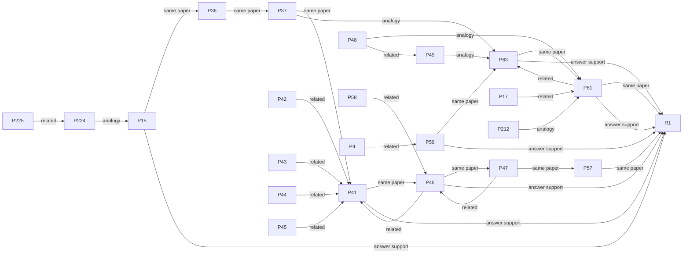
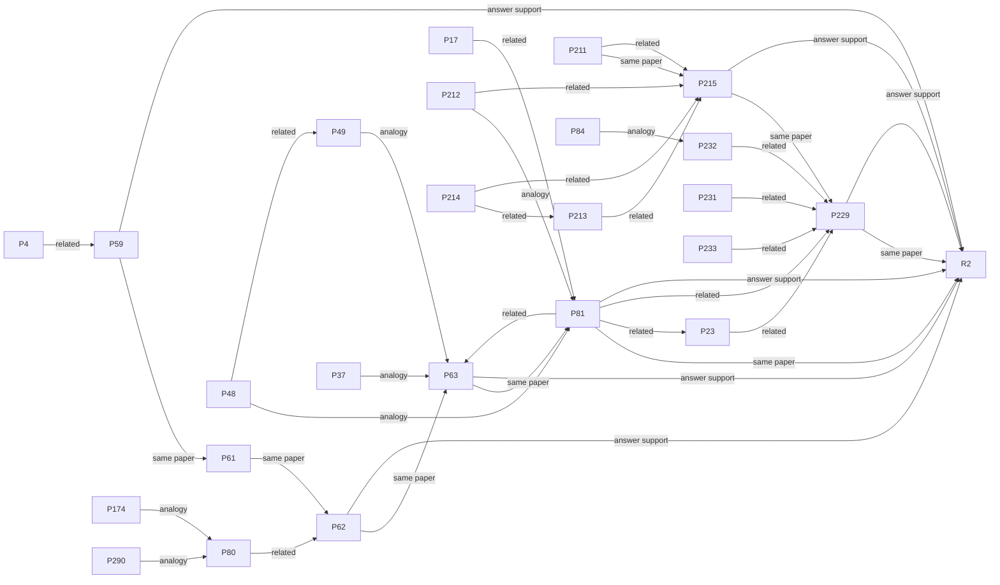
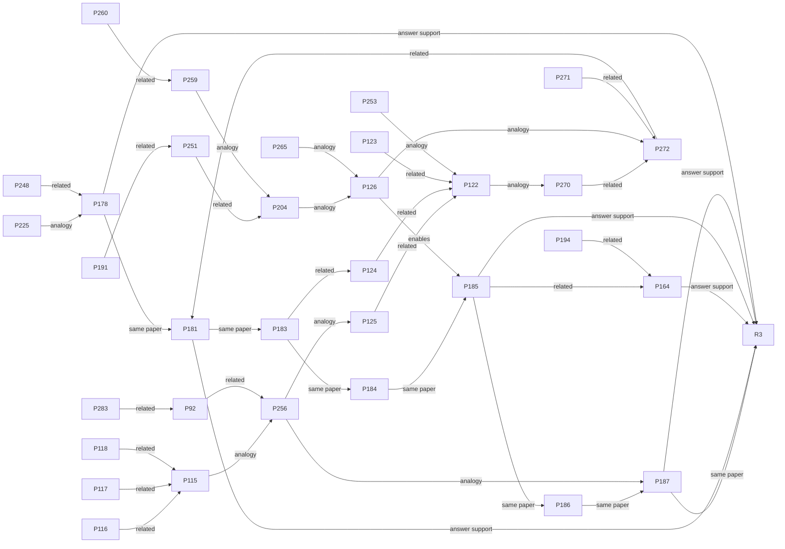
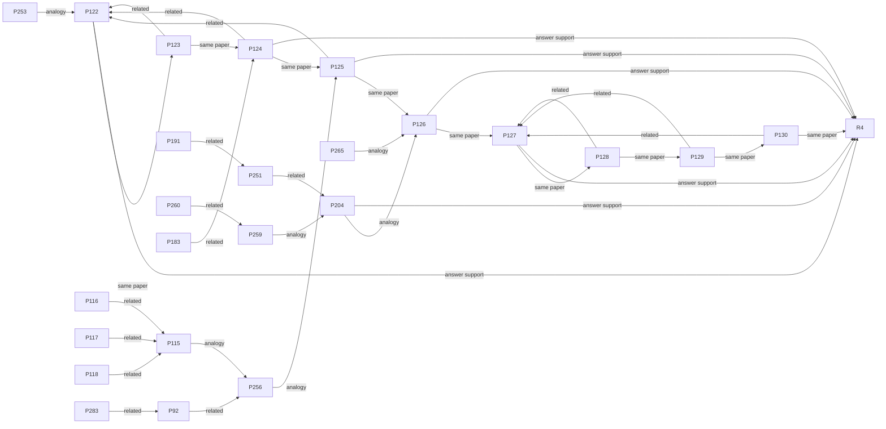
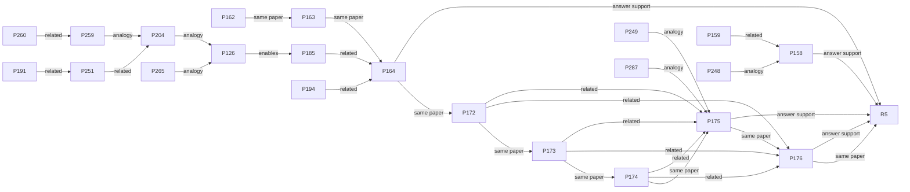

# 指向 R1–R5 的所有多步推理链

日期：2026-10-18

## 说明

- 只收录**至少有一个中间节点**的链；`claim → root` 的直接支持不列为“链”。
- `same-paper`：同一篇论文的直接支持 claim，按 claim 编号排列；这是阅读顺序，不是逻辑推理。
- `graph path`：`answer_layer.exploratory_paths` 中的旧 infer 图路径；边类型来自人工审计，仍不是 typed support chain。
- `analogy` / `infer` 是关系类型，不是 support；本文件不把它们升级为 deduction。
- Mermaid 只画代码节点和边类型；具体内容在下方表格。

## 汇总

| Root | same-paper | graph path | 合计 |
| --- | ---: | ---: | ---: |
| R1 | 2 | 18 | 20 |
| R2 | 2 | 24 | 26 |
| R3 | 1 | 24 | 25 |
| R4 | 1 | 20 | 21 |
| R5 | 1 | 14 | 15 |
| **合计** | **7** | **100** | **107** |

## R1 · 集成概念设计环境

> Aircraft simulation design can be organized around an integrated conceptual-design and simulation-optimization environment that runs an end-to-end civil-airplane design case and uses an optimizer to minimize a design objective such as direct operating cost.

### Mermaid 总图

### 逐链内容

#### R1-01 · same-paper 证据序列 · depth 8

`P15 → P36 → P37 → P41 → P46 → P47 → P57 → R1`

同论文直接支持 claim，按 claim 编号排序；这是阅读顺序，不是逻辑蕴含。

| # | Claim | 内容摘录 | 与下一步的关系 |
| ---: | --- | --- | --- |
| 1 | P15 | The Civil Airplane Conceptual Design System (CACDS) provides a workflow from parametric geometry modeling through analysis to optimization under a unified operating and integration framework. | **same paper** · direct-support reading order |
| 2 | P36 | The Civil Airplane Conceptual Design System (CACDS) is coupled with ModelCenter, a simulation integration and design optimization environment, as the optimization engine by treating CACDS as a functional component with d… | **same paper** · direct-support reading order |
| 3 | P37 | The Civil Airplane Conceptual Design System (CACDS) parses input/output to expose design variables, constraints and objectives to ModelCenter, a simulation integration and design optimization environment. | **same paper** · direct-support reading order |
| 4 | P41 | The CJX 150‑seat single‑aisle civil airplane design case implemented in the Civil Airplane Conceptual Design System (CACDS) demonstrates the environment end‑to‑end. | **same paper** · direct-support reading order |
| 5 | P46 | In the CJX 150‑seat single‑aisle civil airplane design case implemented in the Civil Airplane Conceptual Design System (CACDS), a Direct operating cost (DOC)‑minimization optimization using ModelCenter's (a simulation in… | **same paper** · direct-support reading order |
| 6 | P47 | For the CJX 150-seat civil airplane case, the optimized concept after DOC-minimization optimization using ModelCenter's Boeing Design Explorer optimizer had an inboard wing span of 5.2 m (initial 6.412 m), an outboard wi… | **same paper** · direct-support reading order |
| 7 | P57 | ModelCenter, a simulation integration and design optimization environment, includes the direct Direct Operating Cost minimization template, the flight‑performance optimization template, and the aero‑weight multi‑objectiv… | **same paper** · direct-support reading order |
| 8 | R1 | Aircraft simulation design can be organized around an integrated conceptual-design and simulation-optimization environment that runs an end-to-end civil-airplane design case and uses an optimizer to minimize a design obj… | **answer support** |

#### R1-02 · same-paper 证据序列 · depth 4

`P59 → P63 → P81 → R1`

同论文直接支持 claim，按 claim 编号排序；这是阅读顺序，不是逻辑蕴含。

| # | Claim | 内容摘录 | 与下一步的关系 |
| ---: | --- | --- | --- |
| 1 | P59 | A unified, modular Multidisciplinary Design Optimization framework for conceptual aircraft design was implemented that integrates the main aircraft disciplinary modules into a single optimization environment | **same paper** · direct-support reading order |
| 2 | P63 | Level 2 (the Optimization Module) of the two nested optimization levels supported by the implementation of a unified, modular Multidisciplinary Design Optimization framework for conceptual aircraft design optimizes confi… | **same paper** · direct-support reading order |
| 3 | P81 | Level 2 (the Optimization Module) of the two nested optimization levels supported by the implementation of a unified, modular Multidisciplinary Design Optimization framework for conceptual aircraft design optimizes inter… | **same paper** · direct-support reading order |
| 4 | R1 | Aircraft simulation design can be organized around an integrated conceptual-design and simulation-optimization environment that runs an end-to-end civil-airplane design case and uses an optimizer to minimize a design obj… | **answer support** |

#### R1-03 · graph path（exploratory） · depth 4

`P17 → P81 → P63 → R1`

旧 infer/analogy 图路径；边类型来自人工审计，**不是 typed support chain**。

| # | Claim | 内容摘录 | 与下一步的关系 |
| ---: | --- | --- | --- |
| 1 | P17 | CACDS (Civil Airplane Conceptual Design System) supports fuselage modeling, multi‑section wing modeling, empennage/nacelle modeling, cabin configuration, landing gear geometry/layout, and engine/equipment layout. | **related** · Directed cross-paper relation; no stronger type established, kept as weak infer. |
| 2 | P81 | Level 2 (the Optimization Module) of the two nested optimization levels supported by the implementation of a unified, modular Multidisciplinary Design Optimization framework for conceptual aircraft design optimizes inter… | **related** · paper-internal edge; no Step 3 justification in the final view |
| 3 | P63 | Level 2 (the Optimization Module) of the two nested optimization levels supported by the implementation of a unified, modular Multidisciplinary Design Optimization framework for conceptual aircraft design optimizes confi… | **answer support** |
| 4 | R1 | Aircraft simulation design can be organized around an integrated conceptual-design and simulation-optimization environment that runs an end-to-end civil-airplane design case and uses an optimizer to minimize a design obj… | **answer support** |

#### R1-04 · graph path（exploratory） · depth 4

`P212 → P81 → P63 → R1`

旧 infer/analogy 图路径；边类型来自人工审计，**不是 typed support chain**。

| # | Claim | 内容摘录 | 与下一步的关系 |
| ---: | --- | --- | --- |
| 1 | P212 | Under the +3g and -1g static wing sizing load cases applied to the wing box of the NASA lift-plus-cruise vehicle, the stress constraint was active only at the innermost shear panel in the +3g case. | **analogy** · Cross-aircraft/framework method transfer; kept as analogy, not support. |
| 2 | P81 | Level 2 (the Optimization Module) of the two nested optimization levels supported by the implementation of a unified, modular Multidisciplinary Design Optimization framework for conceptual aircraft design optimizes inter… | **related** · paper-internal edge; no Step 3 justification in the final view |
| 3 | P63 | Level 2 (the Optimization Module) of the two nested optimization levels supported by the implementation of a unified, modular Multidisciplinary Design Optimization framework for conceptual aircraft design optimizes confi… | **answer support** |
| 4 | R1 | Aircraft simulation design can be organized around an integrated conceptual-design and simulation-optimization environment that runs an end-to-end civil-airplane design case and uses an optimizer to minimize a design obj… | **answer support** |

#### R1-05 · graph path（exploratory） · depth 4

`P225 → P224 → P15 → R1`

旧 infer/analogy 图路径；边类型来自人工审计，**不是 typed support chain**。

| # | Claim | 内容摘录 | 与下一步的关系 |
| ---: | --- | --- | --- |
| 1 | P225 | Computational System Design Language enabled efficient handling of the 91 implicit residual equations in the full-scale computational model of the NASA lift-plus-cruise vehicle, avoiding manual analytic derivative implem… | **related** · paper-internal edge; no Step 3 justification in the final view |
| 2 | P224 | Computational System Design Language automates reverse-mode adjoint sensitivity analysis by leveraging the implicit function theorem to compute vector-Jacobian products with a single linear solve at the fixed point of ea… | **analogy** · Cross-aircraft/framework method transfer; kept as analogy, not support. |
| 3 | P15 | The Civil Airplane Conceptual Design System (CACDS) provides a workflow from parametric geometry modeling through analysis to optimization under a unified operating and integration framework. | **answer support** |
| 4 | R1 | Aircraft simulation design can be organized around an integrated conceptual-design and simulation-optimization environment that runs an end-to-end civil-airplane design case and uses an optimizer to minimize a design obj… | **answer support** |

#### R1-06 · graph path（exploratory） · depth 4

`P47 → P46 → P41 → R1`

旧 infer/analogy 图路径；边类型来自人工审计，**不是 typed support chain**。

| # | Claim | 内容摘录 | 与下一步的关系 |
| ---: | --- | --- | --- |
| 1 | P47 | For the CJX 150-seat civil airplane case, the optimized concept after DOC-minimization optimization using ModelCenter's Boeing Design Explorer optimizer had an inboard wing span of 5.2 m (initial 6.412 m), an outboard wi… | **related** · paper-internal edge; no Step 3 justification in the final view |
| 2 | P46 | In the CJX 150‑seat single‑aisle civil airplane design case implemented in the Civil Airplane Conceptual Design System (CACDS), a Direct operating cost (DOC)‑minimization optimization using ModelCenter's (a simulation in… | **related** · paper-internal edge; no Step 3 justification in the final view |
| 3 | P41 | The CJX 150‑seat single‑aisle civil airplane design case implemented in the Civil Airplane Conceptual Design System (CACDS) demonstrates the environment end‑to‑end. | **answer support** |
| 4 | R1 | Aircraft simulation design can be organized around an integrated conceptual-design and simulation-optimization environment that runs an end-to-end civil-airplane design case and uses an optimizer to minimize a design obj… | **answer support** |

#### R1-07 · graph path（exploratory） · depth 4

`P48 → P81 → P63 → R1`

旧 infer/analogy 图路径；边类型来自人工审计，**不是 typed support chain**。

| # | Claim | 内容摘录 | 与下一步的关系 |
| ---: | --- | --- | --- |
| 1 | P48 | In the CJX 150‑seat single‑aisle civil airplane design case implemented in the Civil Airplane Conceptual Design System (CACDS), sensitivity analysis using Design of Experiments (DOE) with a full factorial design computed… | **analogy** · Cross-aircraft/framework method transfer; kept as analogy, not support. |
| 2 | P81 | Level 2 (the Optimization Module) of the two nested optimization levels supported by the implementation of a unified, modular Multidisciplinary Design Optimization framework for conceptual aircraft design optimizes inter… | **related** · paper-internal edge; no Step 3 justification in the final view |
| 3 | P63 | Level 2 (the Optimization Module) of the two nested optimization levels supported by the implementation of a unified, modular Multidisciplinary Design Optimization framework for conceptual aircraft design optimizes confi… | **answer support** |
| 4 | R1 | Aircraft simulation design can be organized around an integrated conceptual-design and simulation-optimization environment that runs an end-to-end civil-airplane design case and uses an optimizer to minimize a design obj… | **answer support** |

#### R1-08 · graph path（exploratory） · depth 4

`P48 → P49 → P63 → R1`

旧 infer/analogy 图路径；边类型来自人工审计，**不是 typed support chain**。

| # | Claim | 内容摘录 | 与下一步的关系 |
| ---: | --- | --- | --- |
| 1 | P48 | In the CJX 150‑seat single‑aisle civil airplane design case implemented in the Civil Airplane Conceptual Design System (CACDS), sensitivity analysis using Design of Experiments (DOE) with a full factorial design computed… | **related** · paper-internal edge; no Step 3 justification in the final view |
| 2 | P49 | Among the seven wing geometric design variables (spanwise lengths, taper ratios, and sweeps of inboard and outboard wing segments, and wing root chord length), spanwise lengths of the inboard and outboard wing segments a… | **analogy** · Cross-aircraft/framework method transfer; kept as analogy, not support. |
| 3 | P63 | Level 2 (the Optimization Module) of the two nested optimization levels supported by the implementation of a unified, modular Multidisciplinary Design Optimization framework for conceptual aircraft design optimizes confi… | **answer support** |
| 4 | R1 | Aircraft simulation design can be organized around an integrated conceptual-design and simulation-optimization environment that runs an end-to-end civil-airplane design case and uses an optimizer to minimize a design obj… | **answer support** |

#### R1-09 · graph path（exploratory） · depth 4

`P58 → P46 → P41 → R1`

旧 infer/analogy 图路径；边类型来自人工审计，**不是 typed support chain**。

| # | Claim | 内容摘录 | 与下一步的关系 |
| ---: | --- | --- | --- |
| 1 | P58 | In the CJX 150‑seat single‑aisle civil airplane design case implemented in the Civil Airplane Conceptual Design System (CACDS), a Direct operating cost (DOC)‑minimization optimization using ModelCenter's (a simulation in… | **related** · paper-internal edge; no Step 3 justification in the final view |
| 2 | P46 | In the CJX 150‑seat single‑aisle civil airplane design case implemented in the Civil Airplane Conceptual Design System (CACDS), a Direct operating cost (DOC)‑minimization optimization using ModelCenter's (a simulation in… | **related** · paper-internal edge; no Step 3 justification in the final view |
| 3 | P41 | The CJX 150‑seat single‑aisle civil airplane design case implemented in the Civil Airplane Conceptual Design System (CACDS) demonstrates the environment end‑to‑end. | **answer support** |
| 4 | R1 | Aircraft simulation design can be organized around an integrated conceptual-design and simulation-optimization environment that runs an end-to-end civil-airplane design case and uses an optimizer to minimize a design obj… | **answer support** |

#### R1-10 · graph path（exploratory） · depth 3

`P17 → P81 → R1`

旧 infer/analogy 图路径；边类型来自人工审计，**不是 typed support chain**。

| # | Claim | 内容摘录 | 与下一步的关系 |
| ---: | --- | --- | --- |
| 1 | P17 | CACDS (Civil Airplane Conceptual Design System) supports fuselage modeling, multi‑section wing modeling, empennage/nacelle modeling, cabin configuration, landing gear geometry/layout, and engine/equipment layout. | **related** · Directed cross-paper relation; no stronger type established, kept as weak infer. |
| 2 | P81 | Level 2 (the Optimization Module) of the two nested optimization levels supported by the implementation of a unified, modular Multidisciplinary Design Optimization framework for conceptual aircraft design optimizes inter… | **answer support** |
| 3 | R1 | Aircraft simulation design can be organized around an integrated conceptual-design and simulation-optimization environment that runs an end-to-end civil-airplane design case and uses an optimizer to minimize a design obj… | **answer support** |

#### R1-11 · graph path（exploratory） · depth 3

`P212 → P81 → R1`

旧 infer/analogy 图路径；边类型来自人工审计，**不是 typed support chain**。

| # | Claim | 内容摘录 | 与下一步的关系 |
| ---: | --- | --- | --- |
| 1 | P212 | Under the +3g and -1g static wing sizing load cases applied to the wing box of the NASA lift-plus-cruise vehicle, the stress constraint was active only at the innermost shear panel in the +3g case. | **analogy** · Cross-aircraft/framework method transfer; kept as analogy, not support. |
| 2 | P81 | Level 2 (the Optimization Module) of the two nested optimization levels supported by the implementation of a unified, modular Multidisciplinary Design Optimization framework for conceptual aircraft design optimizes inter… | **answer support** |
| 3 | R1 | Aircraft simulation design can be organized around an integrated conceptual-design and simulation-optimization environment that runs an end-to-end civil-airplane design case and uses an optimizer to minimize a design obj… | **answer support** |

#### R1-12 · graph path（exploratory） · depth 3

`P37 → P63 → R1`

旧 infer/analogy 图路径；边类型来自人工审计，**不是 typed support chain**。

| # | Claim | 内容摘录 | 与下一步的关系 |
| ---: | --- | --- | --- |
| 1 | P37 | The Civil Airplane Conceptual Design System (CACDS) parses input/output to expose design variables, constraints and objectives to ModelCenter, a simulation integration and design optimization environment. | **analogy** · Cross-aircraft/framework method transfer; kept as analogy, not support. |
| 2 | P63 | Level 2 (the Optimization Module) of the two nested optimization levels supported by the implementation of a unified, modular Multidisciplinary Design Optimization framework for conceptual aircraft design optimizes confi… | **answer support** |
| 3 | R1 | Aircraft simulation design can be organized around an integrated conceptual-design and simulation-optimization environment that runs an end-to-end civil-airplane design case and uses an optimizer to minimize a design obj… | **answer support** |

#### R1-13 · graph path（exploratory） · depth 3

`P4 → P59 → R1`

旧 infer/analogy 图路径；边类型来自人工审计，**不是 typed support chain**。

| # | Claim | 内容摘录 | 与下一步的关系 |
| ---: | --- | --- | --- |
| 1 | P4 | Packaged knowledge components, which contain (i) a hierarchical product data description of the design object and (ii) the methods and tools that generate or analyze that product data, are published to and retrieved from… | **related** · Directed cross-paper relation; no stronger type established, kept as weak infer. |
| 2 | P59 | A unified, modular Multidisciplinary Design Optimization framework for conceptual aircraft design was implemented that integrates the main aircraft disciplinary modules into a single optimization environment | **answer support** |
| 3 | R1 | Aircraft simulation design can be organized around an integrated conceptual-design and simulation-optimization environment that runs an end-to-end civil-airplane design case and uses an optimizer to minimize a design obj… | **answer support** |

#### R1-14 · graph path（exploratory） · depth 3

`P42 → P41 → R1`

旧 infer/analogy 图路径；边类型来自人工审计，**不是 typed support chain**。

| # | Claim | 内容摘录 | 与下一步的关系 |
| ---: | --- | --- | --- |
| 1 | P42 | In the CJX 150‑seat single‑aisle civil airplane design case implemented in the Civil Airplane Conceptual Design System (CACDS), geometry was created in CATIA format via CACDS. | **related** · paper-internal edge; no Step 3 justification in the final view |
| 2 | P41 | The CJX 150‑seat single‑aisle civil airplane design case implemented in the Civil Airplane Conceptual Design System (CACDS) demonstrates the environment end‑to‑end. | **answer support** |
| 3 | R1 | Aircraft simulation design can be organized around an integrated conceptual-design and simulation-optimization environment that runs an end-to-end civil-airplane design case and uses an optimizer to minimize a design obj… | **answer support** |

#### R1-15 · graph path（exploratory） · depth 3

`P43 → P41 → R1`

旧 infer/analogy 图路径；边类型来自人工审计，**不是 typed support chain**。

| # | Claim | 内容摘录 | 与下一步的关系 |
| ---: | --- | --- | --- |
| 1 | P43 | In the CJX 150‑seat single‑aisle civil airplane design case implemented in the Civil Airplane Conceptual Design System (CACDS), automated analyses produced the following representative results: weight breakdown: Maximum … | **related** · paper-internal edge; no Step 3 justification in the final view |
| 2 | P41 | The CJX 150‑seat single‑aisle civil airplane design case implemented in the Civil Airplane Conceptual Design System (CACDS) demonstrates the environment end‑to‑end. | **answer support** |
| 3 | R1 | Aircraft simulation design can be organized around an integrated conceptual-design and simulation-optimization environment that runs an end-to-end civil-airplane design case and uses an optimizer to minimize a design obj… | **answer support** |

#### R1-16 · graph path（exploratory） · depth 3

`P44 → P41 → R1`

旧 infer/analogy 图路径；边类型来自人工审计，**不是 typed support chain**。

| # | Claim | 内容摘录 | 与下一步的关系 |
| ---: | --- | --- | --- |
| 1 | P44 | For the CJX 150-seat single-aisle civil airplane design case implemented in the Civil Airplane Conceptual Design System (CACDS), the cost outputs included a life cycle cost of 115,288.01×10^6 dollars, a Research Developm… | **related** · paper-internal edge; no Step 3 justification in the final view |
| 2 | P41 | The CJX 150‑seat single‑aisle civil airplane design case implemented in the Civil Airplane Conceptual Design System (CACDS) demonstrates the environment end‑to‑end. | **answer support** |
| 3 | R1 | Aircraft simulation design can be organized around an integrated conceptual-design and simulation-optimization environment that runs an end-to-end civil-airplane design case and uses an optimizer to minimize a design obj… | **answer support** |

#### R1-17 · graph path（exploratory） · depth 3

`P45 → P41 → R1`

旧 infer/analogy 图路径；边类型来自人工审计，**不是 typed support chain**。

| # | Claim | 内容摘录 | 与下一步的关系 |
| ---: | --- | --- | --- |
| 1 | P45 | For the CJX 150-seat civil airplane case, aerodynamic evaluation with PANAIR found a wing maximum lift-to-drag ratio of 34.55 at an angle of attack of 2.51°, Mach number Ma = 0.78, and altitude 11 km. | **related** · paper-internal edge; no Step 3 justification in the final view |
| 2 | P41 | The CJX 150‑seat single‑aisle civil airplane design case implemented in the Civil Airplane Conceptual Design System (CACDS) demonstrates the environment end‑to‑end. | **answer support** |
| 3 | R1 | Aircraft simulation design can be organized around an integrated conceptual-design and simulation-optimization environment that runs an end-to-end civil-airplane design case and uses an optimizer to minimize a design obj… | **answer support** |

#### R1-18 · graph path（exploratory） · depth 3

`P47 → P46 → R1`

旧 infer/analogy 图路径；边类型来自人工审计，**不是 typed support chain**。

| # | Claim | 内容摘录 | 与下一步的关系 |
| ---: | --- | --- | --- |
| 1 | P47 | For the CJX 150-seat civil airplane case, the optimized concept after DOC-minimization optimization using ModelCenter's Boeing Design Explorer optimizer had an inboard wing span of 5.2 m (initial 6.412 m), an outboard wi… | **related** · paper-internal edge; no Step 3 justification in the final view |
| 2 | P46 | In the CJX 150‑seat single‑aisle civil airplane design case implemented in the Civil Airplane Conceptual Design System (CACDS), a Direct operating cost (DOC)‑minimization optimization using ModelCenter's (a simulation in… | **answer support** |
| 3 | R1 | Aircraft simulation design can be organized around an integrated conceptual-design and simulation-optimization environment that runs an end-to-end civil-airplane design case and uses an optimizer to minimize a design obj… | **answer support** |

#### R1-19 · graph path（exploratory） · depth 3

`P48 → P81 → R1`

旧 infer/analogy 图路径；边类型来自人工审计，**不是 typed support chain**。

| # | Claim | 内容摘录 | 与下一步的关系 |
| ---: | --- | --- | --- |
| 1 | P48 | In the CJX 150‑seat single‑aisle civil airplane design case implemented in the Civil Airplane Conceptual Design System (CACDS), sensitivity analysis using Design of Experiments (DOE) with a full factorial design computed… | **analogy** · Cross-aircraft/framework method transfer; kept as analogy, not support. |
| 2 | P81 | Level 2 (the Optimization Module) of the two nested optimization levels supported by the implementation of a unified, modular Multidisciplinary Design Optimization framework for conceptual aircraft design optimizes inter… | **answer support** |
| 3 | R1 | Aircraft simulation design can be organized around an integrated conceptual-design and simulation-optimization environment that runs an end-to-end civil-airplane design case and uses an optimizer to minimize a design obj… | **answer support** |

#### R1-20 · graph path（exploratory） · depth 3

`P58 → P46 → R1`

旧 infer/analogy 图路径；边类型来自人工审计，**不是 typed support chain**。

| # | Claim | 内容摘录 | 与下一步的关系 |
| ---: | --- | --- | --- |
| 1 | P58 | In the CJX 150‑seat single‑aisle civil airplane design case implemented in the Civil Airplane Conceptual Design System (CACDS), a Direct operating cost (DOC)‑minimization optimization using ModelCenter's (a simulation in… | **related** · paper-internal edge; no Step 3 justification in the final view |
| 2 | P46 | In the CJX 150‑seat single‑aisle civil airplane design case implemented in the Civil Airplane Conceptual Design System (CACDS), a Direct operating cost (DOC)‑minimization optimization using ModelCenter's (a simulation in… | **answer support** |
| 3 | R1 | Aircraft simulation design can be organized around an integrated conceptual-design and simulation-optimization environment that runs an end-to-end civil-airplane design case and uses an optimizer to minimize a design obj… | **answer support** |

## R2 · 嵌套多学科优化

> Conceptual aircraft design can be pursued through a unified modular multidisciplinary design optimization framework with nested optimization levels that optimize configuration and wing-box design variables, while structural and static-margin constraints may materially affect the resulting design.

### Mermaid 总图

### 逐链内容

#### R2-01 · same-paper 证据序列 · depth 6

`P59 → P61 → P62 → P63 → P81 → R2`

同论文直接支持 claim，按 claim 编号排序；这是阅读顺序，不是逻辑蕴含。

| # | Claim | 内容摘录 | 与下一步的关系 |
| ---: | --- | --- | --- |
| 1 | P59 | A unified, modular Multidisciplinary Design Optimization framework for conceptual aircraft design was implemented that integrates the main aircraft disciplinary modules into a single optimization environment | **same paper** · direct-support reading order |
| 2 | P61 | The implementation of a unified, modular Multidisciplinary Design Optimization framework for conceptual aircraft design supports two nested optimization levels. | **same paper** · direct-support reading order |
| 3 | P62 | Level 1 (the Performance Module) of the two nested optimization levels supported by the implementation of a unified, modular Multidisciplinary Design Optimization framework for conceptual aircraft design performs single-… | **same paper** · direct-support reading order |
| 4 | P63 | Level 2 (the Optimization Module) of the two nested optimization levels supported by the implementation of a unified, modular Multidisciplinary Design Optimization framework for conceptual aircraft design optimizes confi… | **same paper** · direct-support reading order |
| 5 | P81 | Level 2 (the Optimization Module) of the two nested optimization levels supported by the implementation of a unified, modular Multidisciplinary Design Optimization framework for conceptual aircraft design optimizes inter… | **same paper** · direct-support reading order |
| 6 | R2 | Conceptual aircraft design can be pursued through a unified modular multidisciplinary design optimization framework with nested optimization levels that optimize configuration and wing-box design variables, while structu… | **answer support** |

#### R2-02 · same-paper 证据序列 · depth 4

`P211 → P215 → P229 → R2`

同论文直接支持 claim，按 claim 编号排序；这是阅读顺序，不是逻辑蕴含。

| # | Claim | 内容摘录 | 与下一步的关系 |
| ---: | --- | --- | --- |
| 1 | P211 | Under the +3g and -1g static wing sizing load cases applied to the wing box of the NASA lift-plus-cruise vehicle, the wing box was primarily sized by plate buckling constraints. | **same paper** · direct-support reading order |
| 2 | P215 | The full-scale gross-weight multidisciplinary design optimization problem included plate buckling constraints. | **same paper** · direct-support reading order |
| 3 | P229 | In the full-scale gross-weight minimization of the NASA lift-plus-cruise vehicle, enforcing the 8% static-margin constraint increased gross weight by roughly 6% compared with the optimized design without the constraint. | **same paper** · direct-support reading order |
| 4 | R2 | Conceptual aircraft design can be pursued through a unified modular multidisciplinary design optimization framework with nested optimization levels that optimize configuration and wing-box design variables, while structu… | **answer support** |

#### R2-03 · graph path（exploratory） · depth 5

`P17 → P81 → P23 → P229 → R2`

旧 infer/analogy 图路径；边类型来自人工审计，**不是 typed support chain**。

| # | Claim | 内容摘录 | 与下一步的关系 |
| ---: | --- | --- | --- |
| 1 | P17 | CACDS (Civil Airplane Conceptual Design System) supports fuselage modeling, multi‑section wing modeling, empennage/nacelle modeling, cabin configuration, landing gear geometry/layout, and engine/equipment layout. | **related** · Directed cross-paper relation; no stronger type established, kept as weak infer. |
| 2 | P81 | Level 2 (the Optimization Module) of the two nested optimization levels supported by the implementation of a unified, modular Multidisciplinary Design Optimization framework for conceptual aircraft design optimizes inter… | **related** · Directed cross-paper relation; no stronger type established, kept as weak infer. |
| 3 | P23 | Configuration and model parameters are passed automatically from the geometry module to the weight and CoG (center‑of‑gravity) calculations. | **related** · Directed cross-paper relation; no stronger type established, kept as weak infer. |
| 4 | P229 | In the full-scale gross-weight minimization of the NASA lift-plus-cruise vehicle, enforcing the 8% static-margin constraint increased gross weight by roughly 6% compared with the optimized design without the constraint. | **answer support** |
| 5 | R2 | Conceptual aircraft design can be pursued through a unified modular multidisciplinary design optimization framework with nested optimization levels that optimize configuration and wing-box design variables, while structu… | **answer support** |

#### R2-04 · graph path（exploratory） · depth 5

`P212 → P81 → P23 → P229 → R2`

旧 infer/analogy 图路径；边类型来自人工审计，**不是 typed support chain**。

| # | Claim | 内容摘录 | 与下一步的关系 |
| ---: | --- | --- | --- |
| 1 | P212 | Under the +3g and -1g static wing sizing load cases applied to the wing box of the NASA lift-plus-cruise vehicle, the stress constraint was active only at the innermost shear panel in the +3g case. | **analogy** · Cross-aircraft/framework method transfer; kept as analogy, not support. |
| 2 | P81 | Level 2 (the Optimization Module) of the two nested optimization levels supported by the implementation of a unified, modular Multidisciplinary Design Optimization framework for conceptual aircraft design optimizes inter… | **related** · Directed cross-paper relation; no stronger type established, kept as weak infer. |
| 3 | P23 | Configuration and model parameters are passed automatically from the geometry module to the weight and CoG (center‑of‑gravity) calculations. | **related** · Directed cross-paper relation; no stronger type established, kept as weak infer. |
| 4 | P229 | In the full-scale gross-weight minimization of the NASA lift-plus-cruise vehicle, enforcing the 8% static-margin constraint increased gross weight by roughly 6% compared with the optimized design without the constraint. | **answer support** |
| 5 | R2 | Conceptual aircraft design can be pursued through a unified modular multidisciplinary design optimization framework with nested optimization levels that optimize configuration and wing-box design variables, while structu… | **answer support** |

#### R2-05 · graph path（exploratory） · depth 5

`P48 → P81 → P23 → P229 → R2`

旧 infer/analogy 图路径；边类型来自人工审计，**不是 typed support chain**。

| # | Claim | 内容摘录 | 与下一步的关系 |
| ---: | --- | --- | --- |
| 1 | P48 | In the CJX 150‑seat single‑aisle civil airplane design case implemented in the Civil Airplane Conceptual Design System (CACDS), sensitivity analysis using Design of Experiments (DOE) with a full factorial design computed… | **analogy** · Cross-aircraft/framework method transfer; kept as analogy, not support. |
| 2 | P81 | Level 2 (the Optimization Module) of the two nested optimization levels supported by the implementation of a unified, modular Multidisciplinary Design Optimization framework for conceptual aircraft design optimizes inter… | **related** · Directed cross-paper relation; no stronger type established, kept as weak infer. |
| 3 | P23 | Configuration and model parameters are passed automatically from the geometry module to the weight and CoG (center‑of‑gravity) calculations. | **related** · Directed cross-paper relation; no stronger type established, kept as weak infer. |
| 4 | P229 | In the full-scale gross-weight minimization of the NASA lift-plus-cruise vehicle, enforcing the 8% static-margin constraint increased gross weight by roughly 6% compared with the optimized design without the constraint. | **answer support** |
| 5 | R2 | Conceptual aircraft design can be pursued through a unified modular multidisciplinary design optimization framework with nested optimization levels that optimize configuration and wing-box design variables, while structu… | **answer support** |

#### R2-06 · graph path（exploratory） · depth 4

`P17 → P81 → P63 → R2`

旧 infer/analogy 图路径；边类型来自人工审计，**不是 typed support chain**。

| # | Claim | 内容摘录 | 与下一步的关系 |
| ---: | --- | --- | --- |
| 1 | P17 | CACDS (Civil Airplane Conceptual Design System) supports fuselage modeling, multi‑section wing modeling, empennage/nacelle modeling, cabin configuration, landing gear geometry/layout, and engine/equipment layout. | **related** · Directed cross-paper relation; no stronger type established, kept as weak infer. |
| 2 | P81 | Level 2 (the Optimization Module) of the two nested optimization levels supported by the implementation of a unified, modular Multidisciplinary Design Optimization framework for conceptual aircraft design optimizes inter… | **related** · paper-internal edge; no Step 3 justification in the final view |
| 3 | P63 | Level 2 (the Optimization Module) of the two nested optimization levels supported by the implementation of a unified, modular Multidisciplinary Design Optimization framework for conceptual aircraft design optimizes confi… | **answer support** |
| 4 | R2 | Conceptual aircraft design can be pursued through a unified modular multidisciplinary design optimization framework with nested optimization levels that optimize configuration and wing-box design variables, while structu… | **answer support** |

#### R2-07 · graph path（exploratory） · depth 4

`P17 → P81 → P229 → R2`

旧 infer/analogy 图路径；边类型来自人工审计，**不是 typed support chain**。

| # | Claim | 内容摘录 | 与下一步的关系 |
| ---: | --- | --- | --- |
| 1 | P17 | CACDS (Civil Airplane Conceptual Design System) supports fuselage modeling, multi‑section wing modeling, empennage/nacelle modeling, cabin configuration, landing gear geometry/layout, and engine/equipment layout. | **related** · Directed cross-paper relation; no stronger type established, kept as weak infer. |
| 2 | P81 | Level 2 (the Optimization Module) of the two nested optimization levels supported by the implementation of a unified, modular Multidisciplinary Design Optimization framework for conceptual aircraft design optimizes inter… | **related** · Directed cross-paper relation; no stronger type established, kept as weak infer. |
| 3 | P229 | In the full-scale gross-weight minimization of the NASA lift-plus-cruise vehicle, enforcing the 8% static-margin constraint increased gross weight by roughly 6% compared with the optimized design without the constraint. | **answer support** |
| 4 | R2 | Conceptual aircraft design can be pursued through a unified modular multidisciplinary design optimization framework with nested optimization levels that optimize configuration and wing-box design variables, while structu… | **answer support** |

#### R2-08 · graph path（exploratory） · depth 4

`P174 → P80 → P62 → R2`

旧 infer/analogy 图路径；边类型来自人工审计，**不是 typed support chain**。

| # | Claim | 内容摘录 | 与下一步的关系 |
| ---: | --- | --- | --- |
| 1 | P174 | In the joint HIL simulation experiment, the reported simulation results indicate that the engine fuel flow was also controlled well with acceptable tracking error (the permissible tracking errors were specified as $\pm4^… | **analogy** · Cross-aircraft/framework method transfer; kept as analogy, not support. |
| 2 | P80 | Level 1 (the Performance Module) of the two nested optimization levels supported by the implementation of a unified, modular Multidisciplinary Design Optimization framework for conceptual aircraft design performs single-… | **related** · paper-internal edge; no Step 3 justification in the final view |
| 3 | P62 | Level 1 (the Performance Module) of the two nested optimization levels supported by the implementation of a unified, modular Multidisciplinary Design Optimization framework for conceptual aircraft design performs single-… | **answer support** |
| 4 | R2 | Conceptual aircraft design can be pursued through a unified modular multidisciplinary design optimization framework with nested optimization levels that optimize configuration and wing-box design variables, while structu… | **answer support** |

#### R2-09 · graph path（exploratory） · depth 4

`P212 → P81 → P63 → R2`

旧 infer/analogy 图路径；边类型来自人工审计，**不是 typed support chain**。

| # | Claim | 内容摘录 | 与下一步的关系 |
| ---: | --- | --- | --- |
| 1 | P212 | Under the +3g and -1g static wing sizing load cases applied to the wing box of the NASA lift-plus-cruise vehicle, the stress constraint was active only at the innermost shear panel in the +3g case. | **analogy** · Cross-aircraft/framework method transfer; kept as analogy, not support. |
| 2 | P81 | Level 2 (the Optimization Module) of the two nested optimization levels supported by the implementation of a unified, modular Multidisciplinary Design Optimization framework for conceptual aircraft design optimizes inter… | **related** · paper-internal edge; no Step 3 justification in the final view |
| 3 | P63 | Level 2 (the Optimization Module) of the two nested optimization levels supported by the implementation of a unified, modular Multidisciplinary Design Optimization framework for conceptual aircraft design optimizes confi… | **answer support** |
| 4 | R2 | Conceptual aircraft design can be pursued through a unified modular multidisciplinary design optimization framework with nested optimization levels that optimize configuration and wing-box design variables, while structu… | **answer support** |

#### R2-10 · graph path（exploratory） · depth 4

`P212 → P81 → P229 → R2`

旧 infer/analogy 图路径；边类型来自人工审计，**不是 typed support chain**。

| # | Claim | 内容摘录 | 与下一步的关系 |
| ---: | --- | --- | --- |
| 1 | P212 | Under the +3g and -1g static wing sizing load cases applied to the wing box of the NASA lift-plus-cruise vehicle, the stress constraint was active only at the innermost shear panel in the +3g case. | **analogy** · Cross-aircraft/framework method transfer; kept as analogy, not support. |
| 2 | P81 | Level 2 (the Optimization Module) of the two nested optimization levels supported by the implementation of a unified, modular Multidisciplinary Design Optimization framework for conceptual aircraft design optimizes inter… | **related** · Directed cross-paper relation; no stronger type established, kept as weak infer. |
| 3 | P229 | In the full-scale gross-weight minimization of the NASA lift-plus-cruise vehicle, enforcing the 8% static-margin constraint increased gross weight by roughly 6% compared with the optimized design without the constraint. | **answer support** |
| 4 | R2 | Conceptual aircraft design can be pursued through a unified modular multidisciplinary design optimization framework with nested optimization levels that optimize configuration and wing-box design variables, while structu… | **answer support** |

#### R2-11 · graph path（exploratory） · depth 4

`P214 → P213 → P215 → R2`

旧 infer/analogy 图路径；边类型来自人工审计，**不是 typed support chain**。

| # | Claim | 内容摘录 | 与下一步的关系 |
| ---: | --- | --- | --- |
| 1 | P214 | In the one-way coupled aeroelastic wing structural optimization, the displacement constraint remained inactive, with maximum vertical displacements of 0.21–0.24 m against a 0.5 m limit. | **related** · paper-internal edge; no Step 3 justification in the final view |
| 2 | P213 | Under the +3g and -1g static wing sizing load cases applied to the wing box of the NASA lift-plus-cruise vehicle, the displacement constraint remained inactive. | **related** · paper-internal edge; no Step 3 justification in the final view |
| 3 | P215 | The full-scale gross-weight multidisciplinary design optimization problem included plate buckling constraints. | **answer support** |
| 4 | R2 | Conceptual aircraft design can be pursued through a unified modular multidisciplinary design optimization framework with nested optimization levels that optimize configuration and wing-box design variables, while structu… | **answer support** |

#### R2-12 · graph path（exploratory） · depth 4

`P290 → P80 → P62 → R2`

旧 infer/analogy 图路径；边类型来自人工审计，**不是 typed support chain**。

| # | Claim | 内容摘录 | 与下一步的关系 |
| ---: | --- | --- | --- |
| 1 | P290 | A specific fuel consumption surrogate model constructed for Boeing 777 engine data using the regularized minimal-energy tensor-product cubic-splines (RMTC) surrogate model from the SMT: Surrogate Modeling Toolbox replace… | **analogy** · Cross-aircraft/framework method transfer; kept as analogy, not support. |
| 2 | P80 | Level 1 (the Performance Module) of the two nested optimization levels supported by the implementation of a unified, modular Multidisciplinary Design Optimization framework for conceptual aircraft design performs single-… | **related** · paper-internal edge; no Step 3 justification in the final view |
| 3 | P62 | Level 1 (the Performance Module) of the two nested optimization levels supported by the implementation of a unified, modular Multidisciplinary Design Optimization framework for conceptual aircraft design performs single-… | **answer support** |
| 4 | R2 | Conceptual aircraft design can be pursued through a unified modular multidisciplinary design optimization framework with nested optimization levels that optimize configuration and wing-box design variables, while structu… | **answer support** |

#### R2-13 · graph path（exploratory） · depth 4

`P48 → P81 → P63 → R2`

旧 infer/analogy 图路径；边类型来自人工审计，**不是 typed support chain**。

| # | Claim | 内容摘录 | 与下一步的关系 |
| ---: | --- | --- | --- |
| 1 | P48 | In the CJX 150‑seat single‑aisle civil airplane design case implemented in the Civil Airplane Conceptual Design System (CACDS), sensitivity analysis using Design of Experiments (DOE) with a full factorial design computed… | **analogy** · Cross-aircraft/framework method transfer; kept as analogy, not support. |
| 2 | P81 | Level 2 (the Optimization Module) of the two nested optimization levels supported by the implementation of a unified, modular Multidisciplinary Design Optimization framework for conceptual aircraft design optimizes inter… | **related** · paper-internal edge; no Step 3 justification in the final view |
| 3 | P63 | Level 2 (the Optimization Module) of the two nested optimization levels supported by the implementation of a unified, modular Multidisciplinary Design Optimization framework for conceptual aircraft design optimizes confi… | **answer support** |
| 4 | R2 | Conceptual aircraft design can be pursued through a unified modular multidisciplinary design optimization framework with nested optimization levels that optimize configuration and wing-box design variables, while structu… | **answer support** |

#### R2-14 · graph path（exploratory） · depth 4

`P48 → P49 → P63 → R2`

旧 infer/analogy 图路径；边类型来自人工审计，**不是 typed support chain**。

| # | Claim | 内容摘录 | 与下一步的关系 |
| ---: | --- | --- | --- |
| 1 | P48 | In the CJX 150‑seat single‑aisle civil airplane design case implemented in the Civil Airplane Conceptual Design System (CACDS), sensitivity analysis using Design of Experiments (DOE) with a full factorial design computed… | **related** · paper-internal edge; no Step 3 justification in the final view |
| 2 | P49 | Among the seven wing geometric design variables (spanwise lengths, taper ratios, and sweeps of inboard and outboard wing segments, and wing root chord length), spanwise lengths of the inboard and outboard wing segments a… | **analogy** · Cross-aircraft/framework method transfer; kept as analogy, not support. |
| 3 | P63 | Level 2 (the Optimization Module) of the two nested optimization levels supported by the implementation of a unified, modular Multidisciplinary Design Optimization framework for conceptual aircraft design optimizes confi… | **answer support** |
| 4 | R2 | Conceptual aircraft design can be pursued through a unified modular multidisciplinary design optimization framework with nested optimization levels that optimize configuration and wing-box design variables, while structu… | **answer support** |

#### R2-15 · graph path（exploratory） · depth 4

`P48 → P81 → P229 → R2`

旧 infer/analogy 图路径；边类型来自人工审计，**不是 typed support chain**。

| # | Claim | 内容摘录 | 与下一步的关系 |
| ---: | --- | --- | --- |
| 1 | P48 | In the CJX 150‑seat single‑aisle civil airplane design case implemented in the Civil Airplane Conceptual Design System (CACDS), sensitivity analysis using Design of Experiments (DOE) with a full factorial design computed… | **analogy** · Cross-aircraft/framework method transfer; kept as analogy, not support. |
| 2 | P81 | Level 2 (the Optimization Module) of the two nested optimization levels supported by the implementation of a unified, modular Multidisciplinary Design Optimization framework for conceptual aircraft design optimizes inter… | **related** · Directed cross-paper relation; no stronger type established, kept as weak infer. |
| 3 | P229 | In the full-scale gross-weight minimization of the NASA lift-plus-cruise vehicle, enforcing the 8% static-margin constraint increased gross weight by roughly 6% compared with the optimized design without the constraint. | **answer support** |
| 4 | R2 | Conceptual aircraft design can be pursued through a unified modular multidisciplinary design optimization framework with nested optimization levels that optimize configuration and wing-box design variables, while structu… | **answer support** |

#### R2-16 · graph path（exploratory） · depth 4

`P84 → P232 → P229 → R2`

旧 infer/analogy 图路径；边类型来自人工审计，**不是 typed support chain**。

| # | Claim | 内容摘录 | 与下一步的关系 |
| ---: | --- | --- | --- |
| 1 | P84 | Weight and mass breakdowns from JPAD differ by about 1% from public A220 figures. | **analogy** · Cross-aircraft/framework method transfer; kept as analogy, not support. |
| 2 | P232 | In the full-scale gross-weight minimization of the NASA lift-plus-cruise vehicle, the design constrained by enforcing the 8% static-margin constraint had motor mass 23% higher (279 kg versus 227 kg) compared with the opt… | **related** · paper-internal edge; no Step 3 justification in the final view |
| 3 | P229 | In the full-scale gross-weight minimization of the NASA lift-plus-cruise vehicle, enforcing the 8% static-margin constraint increased gross weight by roughly 6% compared with the optimized design without the constraint. | **answer support** |
| 4 | R2 | Conceptual aircraft design can be pursued through a unified modular multidisciplinary design optimization framework with nested optimization levels that optimize configuration and wing-box design variables, while structu… | **answer support** |

#### R2-17 · graph path（exploratory） · depth 3

`P17 → P81 → R2`

旧 infer/analogy 图路径；边类型来自人工审计，**不是 typed support chain**。

| # | Claim | 内容摘录 | 与下一步的关系 |
| ---: | --- | --- | --- |
| 1 | P17 | CACDS (Civil Airplane Conceptual Design System) supports fuselage modeling, multi‑section wing modeling, empennage/nacelle modeling, cabin configuration, landing gear geometry/layout, and engine/equipment layout. | **related** · Directed cross-paper relation; no stronger type established, kept as weak infer. |
| 2 | P81 | Level 2 (the Optimization Module) of the two nested optimization levels supported by the implementation of a unified, modular Multidisciplinary Design Optimization framework for conceptual aircraft design optimizes inter… | **answer support** |
| 3 | R2 | Conceptual aircraft design can be pursued through a unified modular multidisciplinary design optimization framework with nested optimization levels that optimize configuration and wing-box design variables, while structu… | **answer support** |

#### R2-18 · graph path（exploratory） · depth 3

`P211 → P215 → R2`

旧 infer/analogy 图路径；边类型来自人工审计，**不是 typed support chain**。

| # | Claim | 内容摘录 | 与下一步的关系 |
| ---: | --- | --- | --- |
| 1 | P211 | Under the +3g and -1g static wing sizing load cases applied to the wing box of the NASA lift-plus-cruise vehicle, the wing box was primarily sized by plate buckling constraints. | **related** · paper-internal edge; no Step 3 justification in the final view |
| 2 | P215 | The full-scale gross-weight multidisciplinary design optimization problem included plate buckling constraints. | **answer support** |
| 3 | R2 | Conceptual aircraft design can be pursued through a unified modular multidisciplinary design optimization framework with nested optimization levels that optimize configuration and wing-box design variables, while structu… | **answer support** |

#### R2-19 · graph path（exploratory） · depth 3

`P212 → P81 → R2`

旧 infer/analogy 图路径；边类型来自人工审计，**不是 typed support chain**。

| # | Claim | 内容摘录 | 与下一步的关系 |
| ---: | --- | --- | --- |
| 1 | P212 | Under the +3g and -1g static wing sizing load cases applied to the wing box of the NASA lift-plus-cruise vehicle, the stress constraint was active only at the innermost shear panel in the +3g case. | **analogy** · Cross-aircraft/framework method transfer; kept as analogy, not support. |
| 2 | P81 | Level 2 (the Optimization Module) of the two nested optimization levels supported by the implementation of a unified, modular Multidisciplinary Design Optimization framework for conceptual aircraft design optimizes inter… | **answer support** |
| 3 | R2 | Conceptual aircraft design can be pursued through a unified modular multidisciplinary design optimization framework with nested optimization levels that optimize configuration and wing-box design variables, while structu… | **answer support** |

#### R2-20 · graph path（exploratory） · depth 3

`P212 → P215 → R2`

旧 infer/analogy 图路径；边类型来自人工审计，**不是 typed support chain**。

| # | Claim | 内容摘录 | 与下一步的关系 |
| ---: | --- | --- | --- |
| 1 | P212 | Under the +3g and -1g static wing sizing load cases applied to the wing box of the NASA lift-plus-cruise vehicle, the stress constraint was active only at the innermost shear panel in the +3g case. | **related** · paper-internal edge; no Step 3 justification in the final view |
| 2 | P215 | The full-scale gross-weight multidisciplinary design optimization problem included plate buckling constraints. | **answer support** |
| 3 | R2 | Conceptual aircraft design can be pursued through a unified modular multidisciplinary design optimization framework with nested optimization levels that optimize configuration and wing-box design variables, while structu… | **answer support** |

#### R2-21 · graph path（exploratory） · depth 3

`P214 → P215 → R2`

旧 infer/analogy 图路径；边类型来自人工审计，**不是 typed support chain**。

| # | Claim | 内容摘录 | 与下一步的关系 |
| ---: | --- | --- | --- |
| 1 | P214 | In the one-way coupled aeroelastic wing structural optimization, the displacement constraint remained inactive, with maximum vertical displacements of 0.21–0.24 m against a 0.5 m limit. | **related** · paper-internal edge; no Step 3 justification in the final view |
| 2 | P215 | The full-scale gross-weight multidisciplinary design optimization problem included plate buckling constraints. | **answer support** |
| 3 | R2 | Conceptual aircraft design can be pursued through a unified modular multidisciplinary design optimization framework with nested optimization levels that optimize configuration and wing-box design variables, while structu… | **answer support** |

#### R2-22 · graph path（exploratory） · depth 3

`P231 → P229 → R2`

旧 infer/analogy 图路径；边类型来自人工审计，**不是 typed support chain**。

| # | Claim | 内容摘录 | 与下一步的关系 |
| ---: | --- | --- | --- |
| 1 | P231 | In the full-scale gross-weight minimization of the NASA lift-plus-cruise vehicle, the design constrained by enforcing the 8% static-margin constraint had fuselage mass 28% higher (488 kg versus 382 kg) compared with the … | **related** · paper-internal edge; no Step 3 justification in the final view |
| 2 | P229 | In the full-scale gross-weight minimization of the NASA lift-plus-cruise vehicle, enforcing the 8% static-margin constraint increased gross weight by roughly 6% compared with the optimized design without the constraint. | **answer support** |
| 3 | R2 | Conceptual aircraft design can be pursued through a unified modular multidisciplinary design optimization framework with nested optimization levels that optimize configuration and wing-box design variables, while structu… | **answer support** |

#### R2-23 · graph path（exploratory） · depth 3

`P233 → P229 → R2`

旧 infer/analogy 图路径；边类型来自人工审计，**不是 typed support chain**。

| # | Claim | 内容摘录 | 与下一步的关系 |
| ---: | --- | --- | --- |
| 1 | P233 | In the full-scale gross-weight minimization of the NASA lift-plus-cruise vehicle, the design constrained by enforcing the 8% static-margin constraint had battery mass 8% higher (752 kg versus 699 kg) compared with the op… | **related** · paper-internal edge; no Step 3 justification in the final view |
| 2 | P229 | In the full-scale gross-weight minimization of the NASA lift-plus-cruise vehicle, enforcing the 8% static-margin constraint increased gross weight by roughly 6% compared with the optimized design without the constraint. | **answer support** |
| 3 | R2 | Conceptual aircraft design can be pursued through a unified modular multidisciplinary design optimization framework with nested optimization levels that optimize configuration and wing-box design variables, while structu… | **answer support** |

#### R2-24 · graph path（exploratory） · depth 3

`P37 → P63 → R2`

旧 infer/analogy 图路径；边类型来自人工审计，**不是 typed support chain**。

| # | Claim | 内容摘录 | 与下一步的关系 |
| ---: | --- | --- | --- |
| 1 | P37 | The Civil Airplane Conceptual Design System (CACDS) parses input/output to expose design variables, constraints and objectives to ModelCenter, a simulation integration and design optimization environment. | **analogy** · Cross-aircraft/framework method transfer; kept as analogy, not support. |
| 2 | P63 | Level 2 (the Optimization Module) of the two nested optimization levels supported by the implementation of a unified, modular Multidisciplinary Design Optimization framework for conceptual aircraft design optimizes confi… | **answer support** |
| 3 | R2 | Conceptual aircraft design can be pursued through a unified modular multidisciplinary design optimization framework with nested optimization levels that optimize configuration and wing-box design variables, while structu… | **answer support** |

#### R2-25 · graph path（exploratory） · depth 3

`P4 → P59 → R2`

旧 infer/analogy 图路径；边类型来自人工审计，**不是 typed support chain**。

| # | Claim | 内容摘录 | 与下一步的关系 |
| ---: | --- | --- | --- |
| 1 | P4 | Packaged knowledge components, which contain (i) a hierarchical product data description of the design object and (ii) the methods and tools that generate or analyze that product data, are published to and retrieved from… | **related** · Directed cross-paper relation; no stronger type established, kept as weak infer. |
| 2 | P59 | A unified, modular Multidisciplinary Design Optimization framework for conceptual aircraft design was implemented that integrates the main aircraft disciplinary modules into a single optimization environment | **answer support** |
| 3 | R2 | Conceptual aircraft design can be pursued through a unified modular multidisciplinary design optimization framework with nested optimization levels that optimize configuration and wing-box design variables, while structu… | **answer support** |

#### R2-26 · graph path（exploratory） · depth 3

`P48 → P81 → R2`

旧 infer/analogy 图路径；边类型来自人工审计，**不是 typed support chain**。

| # | Claim | 内容摘录 | 与下一步的关系 |
| ---: | --- | --- | --- |
| 1 | P48 | In the CJX 150‑seat single‑aisle civil airplane design case implemented in the Civil Airplane Conceptual Design System (CACDS), sensitivity analysis using Design of Experiments (DOE) with a full factorial design computed… | **analogy** · Cross-aircraft/framework method transfer; kept as analogy, not support. |
| 2 | P81 | Level 2 (the Optimization Module) of the two nested optimization levels supported by the implementation of a unified, modular Multidisciplinary Design Optimization framework for conceptual aircraft design optimizes inter… | **answer support** |
| 3 | R2 | Conceptual aircraft design can be pursued through a unified modular multidisciplinary design optimization framework with nested optimization levels that optimize configuration and wing-box design variables, while structu… | **answer support** |

## R3 · 非线性飞行动力学建模

> Aircraft simulation can be formulated as a coupled nonlinear differential-algebraic flight-dynamics model with six-degree-of-freedom equations expressed in body or wind axes, requiring state variables and parameters to be specified.

### Mermaid 总图

### 逐链内容

#### R3-01 · same-paper 证据序列 · depth 8

`P178 → P181 → P183 → P184 → P185 → P186 → P187 → R3`

同论文直接支持 claim，按 claim 编号排序；这是阅读顺序，不是逻辑蕴含。

| # | Claim | 内容摘录 | 与下一步的关系 |
| ---: | --- | --- | --- |
| 1 | P178 | The flight dynamics model is packaged as a single coupled nonlinear differential‑algebraic system consisting of 35 scalar DAE equations, involving 39 flight variables and requiring 30 independent constant parameters to b… | **same paper** · direct-support reading order |
| 2 | P181 | For the flight dynamics model, in forward simulation, the four variables that must be specified as inputs to obtain a unique solution are the time histories of $(\delta_{l},\delta_{m},\delta_{n},T)$. | **same paper** · direct-support reading order |
| 3 | P183 | The body‑axis angular velocity components $(p,q,r)$ are expressed in closed form in terms of the Euler attitude angles $(\phi,\theta,\psi)$ and their time derivatives $(\dot{\phi},\dot{\theta},\dot{\psi})$ by $$ \begin{a… | **same paper** · direct-support reading order |
| 4 | P184 | One of the three scalar wind‑axis equations, in the wind axes (velocity‑aligned axes), is $$ \begin{aligned} m\dot{V} &= \bar{q}S\!\left(C_x\cos\alpha\cos\beta + C_y\sin\beta + C_z\sin\alpha\cos\beta\right) \\ &\quad + m… | **same paper** · direct-support reading order |
| 5 | P185 | One of the three scalar wind‑axis equations, in the wind axes (velocity‑aligned axes), is $$ \begin{aligned} mV\dot{\beta} &= \bar{q}S\!\left(C_y\cos\beta - C_x\cos\alpha\sin\beta - C_z\sin\alpha\sin\beta\right) \\ &\qua… | **same paper** · direct-support reading order |
| 6 | P186 | One of the three scalar wind‑axis equations, in the wind axes (velocity‑aligned axes), is $$ \begin{aligned} mV\cos\beta\,\dot{\alpha} &= \bar{q}S\!\left(C_z\cos\alpha - C_x\sin\alpha\right) + m g_0(\sin\theta\sin\alpha … | **same paper** · direct-support reading order |
| 7 | P187 | The rotational dynamics for a generic asymmetric aircraft are given as three differential equations for the body angular acceleration components $(\dot{p},\dot{q},\dot{r})$ in terms of the inertia determinant $T_0$ and a… | **same paper** · direct-support reading order |
| 8 | R3 | Aircraft simulation can be formulated as a coupled nonlinear differential-algebraic flight-dynamics model with six-degree-of-freedom equations expressed in body or wind axes, requiring state variables and parameters to b… | **answer support** |

#### R3-02 · graph path（exploratory） · depth 9

`P116 → P115 → P256 → P125 → P122 → P270 → P272 → P181 → R3`

旧 infer/analogy 图路径；边类型来自人工审计，**不是 typed support chain**。

| # | Claim | 内容摘录 | 与下一步的关系 |
| ---: | --- | --- | --- |
| 1 | P116 | In a simulation of pure yaw rotation during hover on the Hexa-Chakra Personal Air Vehicle version 1 (HCPAV-V1), a $90^\circ$ heading change to the right was commanded at t=5 s. | **related** · paper-internal edge; no Step 3 justification in the final view |
| 2 | P115 | Pure yaw rotation during hover was demonstrated on the Hexa-Chakra Personal Air Vehicle version 1 using opposing deflection of front and aft rotor vanes to generate a yawing moment. | **analogy** · Cross-aircraft/framework method transfer; kept as analogy, not support. |
| 3 | P256 | In the integrated aero-propulsive (Approach I) models identified for the CZ-150, propulsion-specific terms were retained in all six nondimensional body-axis force and moment coefficient equations ($C_{T_x}$, $C_{T_y}$, $… | **analogy** · Cross-aircraft/framework method transfer; kept as analogy, not support. |
| 4 | P125 | The estimated parameters and their 95% confidence bounds for the delta aerodynamic model of the longitudinal coefficient ΔC_m, which was estimated for a 450 kg, tail-controlled, gliding autonomous air vehicle using stepw… | **related** · paper-internal edge; no Step 3 justification in the final view |
| 5 | P122 | The delta aerodynamic model for the longitudinal coefficients \(C_X\) (force coefficient in the \(x\)-direction), \(C_Z\) (force coefficient in the \(z\)-direction), and \(C_m\) (moment coefficient about the \(y\)-axis),… | **analogy** · Cross-aircraft/framework method transfer; kept as analogy, not support. |
| 6 | P270 | In the decoupled propulsion model identified from flight data in Approach II, the propulsion model parameters had estimates of C_{X\bar{J}^2} = 0.0427, C_{X\bar{J}} = 0.114, and C_{Xp0} = 0.0664, with parameter standard … | **related** · paper-internal edge; no Step 3 justification in the final view |
| 7 | P272 | The final model $C_{T_x} = C_{T_x,a} + C_{T_x,p}$, where $C_{T_x,a}$ is the bare airframe body x-axis force coefficient model and $C_{T_x,p}$ is the propulsion model, provides a direct flight-derived estimate of installe… | **related** · Directed cross-paper relation; no stronger type established, kept as weak infer. |
| 8 | P181 | For the flight dynamics model, in forward simulation, the four variables that must be specified as inputs to obtain a unique solution are the time histories of $(\delta_{l},\delta_{m},\delta_{n},T)$. | **answer support** |
| 9 | R3 | Aircraft simulation can be formulated as a coupled nonlinear differential-algebraic flight-dynamics model with six-degree-of-freedom equations expressed in body or wind axes, requiring state variables and parameters to b… | **answer support** |

#### R3-03 · graph path（exploratory） · depth 9

`P117 → P115 → P256 → P125 → P122 → P270 → P272 → P181 → R3`

旧 infer/analogy 图路径；边类型来自人工审计，**不是 typed support chain**。

| # | Claim | 内容摘录 | 与下一步的关系 |
| ---: | --- | --- | --- |
| 1 | P117 | In a simulation of pure yaw rotation during hover on the Hexa-Chakra Personal Air Vehicle version 1 (HCPAV-V1), a $90^\circ$ turn back to the original heading was commanded at t=20 s. | **related** · paper-internal edge; no Step 3 justification in the final view |
| 2 | P115 | Pure yaw rotation during hover was demonstrated on the Hexa-Chakra Personal Air Vehicle version 1 using opposing deflection of front and aft rotor vanes to generate a yawing moment. | **analogy** · Cross-aircraft/framework method transfer; kept as analogy, not support. |
| 3 | P256 | In the integrated aero-propulsive (Approach I) models identified for the CZ-150, propulsion-specific terms were retained in all six nondimensional body-axis force and moment coefficient equations ($C_{T_x}$, $C_{T_y}$, $… | **analogy** · Cross-aircraft/framework method transfer; kept as analogy, not support. |
| 4 | P125 | The estimated parameters and their 95% confidence bounds for the delta aerodynamic model of the longitudinal coefficient ΔC_m, which was estimated for a 450 kg, tail-controlled, gliding autonomous air vehicle using stepw… | **related** · paper-internal edge; no Step 3 justification in the final view |
| 5 | P122 | The delta aerodynamic model for the longitudinal coefficients \(C_X\) (force coefficient in the \(x\)-direction), \(C_Z\) (force coefficient in the \(z\)-direction), and \(C_m\) (moment coefficient about the \(y\)-axis),… | **analogy** · Cross-aircraft/framework method transfer; kept as analogy, not support. |
| 6 | P270 | In the decoupled propulsion model identified from flight data in Approach II, the propulsion model parameters had estimates of C_{X\bar{J}^2} = 0.0427, C_{X\bar{J}} = 0.114, and C_{Xp0} = 0.0664, with parameter standard … | **related** · paper-internal edge; no Step 3 justification in the final view |
| 7 | P272 | The final model $C_{T_x} = C_{T_x,a} + C_{T_x,p}$, where $C_{T_x,a}$ is the bare airframe body x-axis force coefficient model and $C_{T_x,p}$ is the propulsion model, provides a direct flight-derived estimate of installe… | **related** · Directed cross-paper relation; no stronger type established, kept as weak infer. |
| 8 | P181 | For the flight dynamics model, in forward simulation, the four variables that must be specified as inputs to obtain a unique solution are the time histories of $(\delta_{l},\delta_{m},\delta_{n},T)$. | **answer support** |
| 9 | R3 | Aircraft simulation can be formulated as a coupled nonlinear differential-algebraic flight-dynamics model with six-degree-of-freedom equations expressed in body or wind axes, requiring state variables and parameters to b… | **answer support** |

#### R3-04 · graph path（exploratory） · depth 9

`P118 → P115 → P256 → P125 → P122 → P270 → P272 → P181 → R3`

旧 infer/analogy 图路径；边类型来自人工审计，**不是 typed support chain**。

| # | Claim | 内容摘录 | 与下一步的关系 |
| ---: | --- | --- | --- |
| 1 | P118 | In a simulation, the front and aft vanes of the Hexa-Chakra Personal Air Vehicle version 1 deflected in opposite directions to produce the necessary yawing moments to start and stop the pure yaw rotation during hover. | **related** · paper-internal edge; no Step 3 justification in the final view |
| 2 | P115 | Pure yaw rotation during hover was demonstrated on the Hexa-Chakra Personal Air Vehicle version 1 using opposing deflection of front and aft rotor vanes to generate a yawing moment. | **analogy** · Cross-aircraft/framework method transfer; kept as analogy, not support. |
| 3 | P256 | In the integrated aero-propulsive (Approach I) models identified for the CZ-150, propulsion-specific terms were retained in all six nondimensional body-axis force and moment coefficient equations ($C_{T_x}$, $C_{T_y}$, $… | **analogy** · Cross-aircraft/framework method transfer; kept as analogy, not support. |
| 4 | P125 | The estimated parameters and their 95% confidence bounds for the delta aerodynamic model of the longitudinal coefficient ΔC_m, which was estimated for a 450 kg, tail-controlled, gliding autonomous air vehicle using stepw… | **related** · paper-internal edge; no Step 3 justification in the final view |
| 5 | P122 | The delta aerodynamic model for the longitudinal coefficients \(C_X\) (force coefficient in the \(x\)-direction), \(C_Z\) (force coefficient in the \(z\)-direction), and \(C_m\) (moment coefficient about the \(y\)-axis),… | **analogy** · Cross-aircraft/framework method transfer; kept as analogy, not support. |
| 6 | P270 | In the decoupled propulsion model identified from flight data in Approach II, the propulsion model parameters had estimates of C_{X\bar{J}^2} = 0.0427, C_{X\bar{J}} = 0.114, and C_{Xp0} = 0.0664, with parameter standard … | **related** · paper-internal edge; no Step 3 justification in the final view |
| 7 | P272 | The final model $C_{T_x} = C_{T_x,a} + C_{T_x,p}$, where $C_{T_x,a}$ is the bare airframe body x-axis force coefficient model and $C_{T_x,p}$ is the propulsion model, provides a direct flight-derived estimate of installe… | **related** · Directed cross-paper relation; no stronger type established, kept as weak infer. |
| 8 | P181 | For the flight dynamics model, in forward simulation, the four variables that must be specified as inputs to obtain a unique solution are the time histories of $(\delta_{l},\delta_{m},\delta_{n},T)$. | **answer support** |
| 9 | R3 | Aircraft simulation can be formulated as a coupled nonlinear differential-algebraic flight-dynamics model with six-degree-of-freedom equations expressed in body or wind axes, requiring state variables and parameters to b… | **answer support** |

#### R3-05 · graph path（exploratory） · depth 9

`P283 → P92 → P256 → P125 → P122 → P270 → P272 → P181 → R3`

旧 infer/analogy 图路径；边类型来自人工审计，**不是 typed support chain**。

| # | Claim | 内容摘录 | 与下一步的关系 |
| ---: | --- | --- | --- |
| 1 | P283 | Propeller thrust is highest at low advance ratio $J_{adv} = V/(nD)$ (high thrust). | **related** · Directed cross-paper relation; no stronger type established, kept as weak infer. |
| 2 | P92 | The resulting database of MATLAB griddedInterpolants for force and moment coefficients was queried within the simulation framework to produce total airplane lift and drag coefficients with and without high-lift propeller… | **related** · Directed cross-paper relation; no stronger type established, kept as weak infer. |
| 3 | P256 | In the integrated aero-propulsive (Approach I) models identified for the CZ-150, propulsion-specific terms were retained in all six nondimensional body-axis force and moment coefficient equations ($C_{T_x}$, $C_{T_y}$, $… | **analogy** · Cross-aircraft/framework method transfer; kept as analogy, not support. |
| 4 | P125 | The estimated parameters and their 95% confidence bounds for the delta aerodynamic model of the longitudinal coefficient ΔC_m, which was estimated for a 450 kg, tail-controlled, gliding autonomous air vehicle using stepw… | **related** · paper-internal edge; no Step 3 justification in the final view |
| 5 | P122 | The delta aerodynamic model for the longitudinal coefficients \(C_X\) (force coefficient in the \(x\)-direction), \(C_Z\) (force coefficient in the \(z\)-direction), and \(C_m\) (moment coefficient about the \(y\)-axis),… | **analogy** · Cross-aircraft/framework method transfer; kept as analogy, not support. |
| 6 | P270 | In the decoupled propulsion model identified from flight data in Approach II, the propulsion model parameters had estimates of C_{X\bar{J}^2} = 0.0427, C_{X\bar{J}} = 0.114, and C_{Xp0} = 0.0664, with parameter standard … | **related** · paper-internal edge; no Step 3 justification in the final view |
| 7 | P272 | The final model $C_{T_x} = C_{T_x,a} + C_{T_x,p}$, where $C_{T_x,a}$ is the bare airframe body x-axis force coefficient model and $C_{T_x,p}$ is the propulsion model, provides a direct flight-derived estimate of installe… | **related** · Directed cross-paper relation; no stronger type established, kept as weak infer. |
| 8 | P181 | For the flight dynamics model, in forward simulation, the four variables that must be specified as inputs to obtain a unique solution are the time histories of $(\delta_{l},\delta_{m},\delta_{n},T)$. | **answer support** |
| 9 | R3 | Aircraft simulation can be formulated as a coupled nonlinear differential-algebraic flight-dynamics model with six-degree-of-freedom equations expressed in body or wind axes, requiring state variables and parameters to b… | **answer support** |

#### R3-06 · graph path（exploratory） · depth 7

`P183 → P124 → P122 → P270 → P272 → P181 → R3`

旧 infer/analogy 图路径；边类型来自人工审计，**不是 typed support chain**。

| # | Claim | 内容摘录 | 与下一步的关系 |
| ---: | --- | --- | --- |
| 1 | P183 | The body‑axis angular velocity components $(p,q,r)$ are expressed in closed form in terms of the Euler attitude angles $(\phi,\theta,\psi)$ and their time derivatives $(\dot{\phi},\dot{\theta},\dot{\psi})$ by $$ \begin{a… | **related** · Directed cross-paper relation; no stronger type established, kept as weak infer. |
| 2 | P124 | The estimated parameters and their 95% confidence bounds for the delta aerodynamic model of the longitudinal coefficient ΔC_Z, which was estimated for a 450 kg, tail-controlled, gliding autonomous air vehicle using stepw… | **related** · paper-internal edge; no Step 3 justification in the final view |
| 3 | P122 | The delta aerodynamic model for the longitudinal coefficients \(C_X\) (force coefficient in the \(x\)-direction), \(C_Z\) (force coefficient in the \(z\)-direction), and \(C_m\) (moment coefficient about the \(y\)-axis),… | **analogy** · Cross-aircraft/framework method transfer; kept as analogy, not support. |
| 4 | P270 | In the decoupled propulsion model identified from flight data in Approach II, the propulsion model parameters had estimates of C_{X\bar{J}^2} = 0.0427, C_{X\bar{J}} = 0.114, and C_{Xp0} = 0.0664, with parameter standard … | **related** · paper-internal edge; no Step 3 justification in the final view |
| 5 | P272 | The final model $C_{T_x} = C_{T_x,a} + C_{T_x,p}$, where $C_{T_x,a}$ is the bare airframe body x-axis force coefficient model and $C_{T_x,p}$ is the propulsion model, provides a direct flight-derived estimate of installe… | **related** · Directed cross-paper relation; no stronger type established, kept as weak infer. |
| 6 | P181 | For the flight dynamics model, in forward simulation, the four variables that must be specified as inputs to obtain a unique solution are the time histories of $(\delta_{l},\delta_{m},\delta_{n},T)$. | **answer support** |
| 7 | R3 | Aircraft simulation can be formulated as a coupled nonlinear differential-algebraic flight-dynamics model with six-degree-of-freedom equations expressed in body or wind axes, requiring state variables and parameters to b… | **answer support** |

#### R3-07 · graph path（exploratory） · depth 7

`P191 → P251 → P204 → P126 → P272 → P181 → R3`

旧 infer/analogy 图路径；边类型来自人工审计，**不是 typed support chain**。

| # | Claim | 内容摘录 | 与下一步的关系 |
| ---: | --- | --- | --- |
| 1 | P191 | Using the constants in note 1, the air density at any altitude within the range up to 20,000 m can be computed. | **related** · Directed cross-paper relation; no stronger type established, kept as weak infer. |
| 2 | P251 | The thrust coefficient definition $C_T = T/(\rho n^2 D^4)$, with $T$ the thrust and $\rho$ the air density, with the body-axis force coefficient normalization, in which the thrust force is divided by the freestream dynam… | **related** · Directed cross-paper relation; no stronger type established, kept as weak infer. |
| 3 | P204 | A two-step longitudinal parameter-identification procedure for a fixed-wing unmanned aerial vehicle (UAV), applied to simulated elevator-doublet flight data at 1000 m altitude and 42 m/s nominal airspeed, reproduces the … | **analogy** · Cross-aircraft/framework method transfer; kept as analogy, not support. |
| 4 | P126 | The delta aerodynamic model for the longitudinal coefficients \(C_X\) (force coefficient in the \(x\)-direction), \(C_Z\) (force coefficient in the \(z\)-direction), and \(C_m\) (moment coefficient about the \(y\)-axis),… | **analogy** · Cross-aircraft/framework method transfer; kept as analogy, not support. |
| 5 | P272 | The final model $C_{T_x} = C_{T_x,a} + C_{T_x,p}$, where $C_{T_x,a}$ is the bare airframe body x-axis force coefficient model and $C_{T_x,p}$ is the propulsion model, provides a direct flight-derived estimate of installe… | **related** · Directed cross-paper relation; no stronger type established, kept as weak infer. |
| 6 | P181 | For the flight dynamics model, in forward simulation, the four variables that must be specified as inputs to obtain a unique solution are the time histories of $(\delta_{l},\delta_{m},\delta_{n},T)$. | **answer support** |
| 7 | R3 | Aircraft simulation can be formulated as a coupled nonlinear differential-algebraic flight-dynamics model with six-degree-of-freedom equations expressed in body or wind axes, requiring state variables and parameters to b… | **answer support** |

#### R3-08 · graph path（exploratory） · depth 7

`P191 → P251 → P204 → P126 → P185 → P164 → R3`

旧 infer/analogy 图路径；边类型来自人工审计，**不是 typed support chain**。

| # | Claim | 内容摘录 | 与下一步的关系 |
| ---: | --- | --- | --- |
| 1 | P191 | Using the constants in note 1, the air density at any altitude within the range up to 20,000 m can be computed. | **related** · Directed cross-paper relation; no stronger type established, kept as weak infer. |
| 2 | P251 | The thrust coefficient definition $C_T = T/(\rho n^2 D^4)$, with $T$ the thrust and $\rho$ the air density, with the body-axis force coefficient normalization, in which the thrust force is divided by the freestream dynam… | **related** · Directed cross-paper relation; no stronger type established, kept as weak infer. |
| 3 | P204 | A two-step longitudinal parameter-identification procedure for a fixed-wing unmanned aerial vehicle (UAV), applied to simulated elevator-doublet flight data at 1000 m altitude and 42 m/s nominal airspeed, reproduces the … | **analogy** · Cross-aircraft/framework method transfer; kept as analogy, not support. |
| 4 | P126 | The delta aerodynamic model for the longitudinal coefficients \(C_X\) (force coefficient in the \(x\)-direction), \(C_Z\) (force coefficient in the \(z\)-direction), and \(C_m\) (moment coefficient about the \(y\)-axis),… | **enables** · The delta model supplies coefficients used by the wind-axis equation; this is enabling, not reproduction. |
| 5 | P185 | One of the three scalar wind‑axis equations, in the wind axes (velocity‑aligned axes), is $$ \begin{aligned} mV\dot{\beta} &= \bar{q}S\!\left(C_y\cos\beta - C_x\cos\alpha\sin\beta - C_z\sin\alpha\sin\beta\right) \\ &\qua… | **related** · Directed cross-paper relation; no stronger type established, kept as weak infer. |
| 6 | P164 | In each cycle of the real-time simulation, the ground simulation computer of the joint real-time hardware-in-the-loop simulation system for an aircraft computes the aircraft dynamics differential equations and generates … | **answer support** |
| 7 | R3 | Aircraft simulation can be formulated as a coupled nonlinear differential-algebraic flight-dynamics model with six-degree-of-freedom equations expressed in body or wind axes, requiring state variables and parameters to b… | **answer support** |

#### R3-09 · graph path（exploratory） · depth 7

`P260 → P259 → P204 → P126 → P272 → P181 → R3`

旧 infer/analogy 图路径；边类型来自人工审计，**不是 typed support chain**。

| # | Claim | 内容摘录 | 与下一步的关系 |
| ---: | --- | --- | --- |
| 1 | P260 | For the CZ-150, the propeller axis of rotation is canted to counteract the asymmetric effects of the single-propeller configuration. | **related** · paper-internal edge; no Step 3 justification in the final view |
| 2 | P259 | Propeller incidence-angle contributions to the rolling-, pitching-, and yawing-moment models were too small to warrant inclusion for the CZ-150. | **analogy** · Different aircraft/quantity; not an independent reproduction. |
| 3 | P204 | A two-step longitudinal parameter-identification procedure for a fixed-wing unmanned aerial vehicle (UAV), applied to simulated elevator-doublet flight data at 1000 m altitude and 42 m/s nominal airspeed, reproduces the … | **analogy** · Cross-aircraft/framework method transfer; kept as analogy, not support. |
| 4 | P126 | The delta aerodynamic model for the longitudinal coefficients \(C_X\) (force coefficient in the \(x\)-direction), \(C_Z\) (force coefficient in the \(z\)-direction), and \(C_m\) (moment coefficient about the \(y\)-axis),… | **analogy** · Cross-aircraft/framework method transfer; kept as analogy, not support. |
| 5 | P272 | The final model $C_{T_x} = C_{T_x,a} + C_{T_x,p}$, where $C_{T_x,a}$ is the bare airframe body x-axis force coefficient model and $C_{T_x,p}$ is the propulsion model, provides a direct flight-derived estimate of installe… | **related** · Directed cross-paper relation; no stronger type established, kept as weak infer. |
| 6 | P181 | For the flight dynamics model, in forward simulation, the four variables that must be specified as inputs to obtain a unique solution are the time histories of $(\delta_{l},\delta_{m},\delta_{n},T)$. | **answer support** |
| 7 | R3 | Aircraft simulation can be formulated as a coupled nonlinear differential-algebraic flight-dynamics model with six-degree-of-freedom equations expressed in body or wind axes, requiring state variables and parameters to b… | **answer support** |

#### R3-10 · graph path（exploratory） · depth 7

`P260 → P259 → P204 → P126 → P185 → P164 → R3`

旧 infer/analogy 图路径；边类型来自人工审计，**不是 typed support chain**。

| # | Claim | 内容摘录 | 与下一步的关系 |
| ---: | --- | --- | --- |
| 1 | P260 | For the CZ-150, the propeller axis of rotation is canted to counteract the asymmetric effects of the single-propeller configuration. | **related** · paper-internal edge; no Step 3 justification in the final view |
| 2 | P259 | Propeller incidence-angle contributions to the rolling-, pitching-, and yawing-moment models were too small to warrant inclusion for the CZ-150. | **analogy** · Different aircraft/quantity; not an independent reproduction. |
| 3 | P204 | A two-step longitudinal parameter-identification procedure for a fixed-wing unmanned aerial vehicle (UAV), applied to simulated elevator-doublet flight data at 1000 m altitude and 42 m/s nominal airspeed, reproduces the … | **analogy** · Cross-aircraft/framework method transfer; kept as analogy, not support. |
| 4 | P126 | The delta aerodynamic model for the longitudinal coefficients \(C_X\) (force coefficient in the \(x\)-direction), \(C_Z\) (force coefficient in the \(z\)-direction), and \(C_m\) (moment coefficient about the \(y\)-axis),… | **enables** · The delta model supplies coefficients used by the wind-axis equation; this is enabling, not reproduction. |
| 5 | P185 | One of the three scalar wind‑axis equations, in the wind axes (velocity‑aligned axes), is $$ \begin{aligned} mV\dot{\beta} &= \bar{q}S\!\left(C_y\cos\beta - C_x\cos\alpha\sin\beta - C_z\sin\alpha\sin\beta\right) \\ &\qua… | **related** · Directed cross-paper relation; no stronger type established, kept as weak infer. |
| 6 | P164 | In each cycle of the real-time simulation, the ground simulation computer of the joint real-time hardware-in-the-loop simulation system for an aircraft computes the aircraft dynamics differential equations and generates … | **answer support** |
| 7 | R3 | Aircraft simulation can be formulated as a coupled nonlinear differential-algebraic flight-dynamics model with six-degree-of-freedom equations expressed in body or wind axes, requiring state variables and parameters to b… | **answer support** |

#### R3-11 · graph path（exploratory） · depth 6

`P123 → P122 → P270 → P272 → P181 → R3`

旧 infer/analogy 图路径；边类型来自人工审计，**不是 typed support chain**。

| # | Claim | 内容摘录 | 与下一步的关系 |
| ---: | --- | --- | --- |
| 1 | P123 | The estimated parameters and their 95% confidence bounds for the delta aerodynamic model of the longitudinal coefficient ΔC_X, which was estimated for a 450 kg, tail-controlled, gliding autonomous air vehicle using stepw… | **related** · paper-internal edge; no Step 3 justification in the final view |
| 2 | P122 | The delta aerodynamic model for the longitudinal coefficients \(C_X\) (force coefficient in the \(x\)-direction), \(C_Z\) (force coefficient in the \(z\)-direction), and \(C_m\) (moment coefficient about the \(y\)-axis),… | **analogy** · Cross-aircraft/framework method transfer; kept as analogy, not support. |
| 3 | P270 | In the decoupled propulsion model identified from flight data in Approach II, the propulsion model parameters had estimates of C_{X\bar{J}^2} = 0.0427, C_{X\bar{J}} = 0.114, and C_{Xp0} = 0.0664, with parameter standard … | **related** · paper-internal edge; no Step 3 justification in the final view |
| 4 | P272 | The final model $C_{T_x} = C_{T_x,a} + C_{T_x,p}$, where $C_{T_x,a}$ is the bare airframe body x-axis force coefficient model and $C_{T_x,p}$ is the propulsion model, provides a direct flight-derived estimate of installe… | **related** · Directed cross-paper relation; no stronger type established, kept as weak infer. |
| 5 | P181 | For the flight dynamics model, in forward simulation, the four variables that must be specified as inputs to obtain a unique solution are the time histories of $(\delta_{l},\delta_{m},\delta_{n},T)$. | **answer support** |
| 6 | R3 | Aircraft simulation can be formulated as a coupled nonlinear differential-algebraic flight-dynamics model with six-degree-of-freedom equations expressed in body or wind axes, requiring state variables and parameters to b… | **answer support** |

#### R3-12 · graph path（exploratory） · depth 6

`P191 → P251 → P204 → P126 → P185 → R3`

旧 infer/analogy 图路径；边类型来自人工审计，**不是 typed support chain**。

| # | Claim | 内容摘录 | 与下一步的关系 |
| ---: | --- | --- | --- |
| 1 | P191 | Using the constants in note 1, the air density at any altitude within the range up to 20,000 m can be computed. | **related** · Directed cross-paper relation; no stronger type established, kept as weak infer. |
| 2 | P251 | The thrust coefficient definition $C_T = T/(\rho n^2 D^4)$, with $T$ the thrust and $\rho$ the air density, with the body-axis force coefficient normalization, in which the thrust force is divided by the freestream dynam… | **related** · Directed cross-paper relation; no stronger type established, kept as weak infer. |
| 3 | P204 | A two-step longitudinal parameter-identification procedure for a fixed-wing unmanned aerial vehicle (UAV), applied to simulated elevator-doublet flight data at 1000 m altitude and 42 m/s nominal airspeed, reproduces the … | **analogy** · Cross-aircraft/framework method transfer; kept as analogy, not support. |
| 4 | P126 | The delta aerodynamic model for the longitudinal coefficients \(C_X\) (force coefficient in the \(x\)-direction), \(C_Z\) (force coefficient in the \(z\)-direction), and \(C_m\) (moment coefficient about the \(y\)-axis),… | **enables** · The delta model supplies coefficients used by the wind-axis equation; this is enabling, not reproduction. |
| 5 | P185 | One of the three scalar wind‑axis equations, in the wind axes (velocity‑aligned axes), is $$ \begin{aligned} mV\dot{\beta} &= \bar{q}S\!\left(C_y\cos\beta - C_x\cos\alpha\sin\beta - C_z\sin\alpha\sin\beta\right) \\ &\qua… | **answer support** |
| 6 | R3 | Aircraft simulation can be formulated as a coupled nonlinear differential-algebraic flight-dynamics model with six-degree-of-freedom equations expressed in body or wind axes, requiring state variables and parameters to b… | **answer support** |

#### R3-13 · graph path（exploratory） · depth 6

`P253 → P122 → P270 → P272 → P181 → R3`

旧 infer/analogy 图路径；边类型来自人工审计，**不是 typed support chain**。

| # | Claim | 内容摘录 | 与下一步的关系 |
| ---: | --- | --- | --- |
| 1 | P253 | In a controlled comparison using identical polynomial model structures fitted to the CZ-150 body x-axis force coefficient $C_{T_x}$, where $J = nD/V$ and $J_{adv} = V/(nD)$ with $V$ the true airspeed, $n$ the propulsor r… | **analogy** · Cross-aircraft/framework method transfer; kept as analogy, not support. |
| 2 | P122 | The delta aerodynamic model for the longitudinal coefficients \(C_X\) (force coefficient in the \(x\)-direction), \(C_Z\) (force coefficient in the \(z\)-direction), and \(C_m\) (moment coefficient about the \(y\)-axis),… | **analogy** · Cross-aircraft/framework method transfer; kept as analogy, not support. |
| 3 | P270 | In the decoupled propulsion model identified from flight data in Approach II, the propulsion model parameters had estimates of C_{X\bar{J}^2} = 0.0427, C_{X\bar{J}} = 0.114, and C_{Xp0} = 0.0664, with parameter standard … | **related** · paper-internal edge; no Step 3 justification in the final view |
| 4 | P272 | The final model $C_{T_x} = C_{T_x,a} + C_{T_x,p}$, where $C_{T_x,a}$ is the bare airframe body x-axis force coefficient model and $C_{T_x,p}$ is the propulsion model, provides a direct flight-derived estimate of installe… | **related** · Directed cross-paper relation; no stronger type established, kept as weak infer. |
| 5 | P181 | For the flight dynamics model, in forward simulation, the four variables that must be specified as inputs to obtain a unique solution are the time histories of $(\delta_{l},\delta_{m},\delta_{n},T)$. | **answer support** |
| 6 | R3 | Aircraft simulation can be formulated as a coupled nonlinear differential-algebraic flight-dynamics model with six-degree-of-freedom equations expressed in body or wind axes, requiring state variables and parameters to b… | **answer support** |

#### R3-14 · graph path（exploratory） · depth 6

`P260 → P259 → P204 → P126 → P185 → R3`

旧 infer/analogy 图路径；边类型来自人工审计，**不是 typed support chain**。

| # | Claim | 内容摘录 | 与下一步的关系 |
| ---: | --- | --- | --- |
| 1 | P260 | For the CZ-150, the propeller axis of rotation is canted to counteract the asymmetric effects of the single-propeller configuration. | **related** · paper-internal edge; no Step 3 justification in the final view |
| 2 | P259 | Propeller incidence-angle contributions to the rolling-, pitching-, and yawing-moment models were too small to warrant inclusion for the CZ-150. | **analogy** · Different aircraft/quantity; not an independent reproduction. |
| 3 | P204 | A two-step longitudinal parameter-identification procedure for a fixed-wing unmanned aerial vehicle (UAV), applied to simulated elevator-doublet flight data at 1000 m altitude and 42 m/s nominal airspeed, reproduces the … | **analogy** · Cross-aircraft/framework method transfer; kept as analogy, not support. |
| 4 | P126 | The delta aerodynamic model for the longitudinal coefficients \(C_X\) (force coefficient in the \(x\)-direction), \(C_Z\) (force coefficient in the \(z\)-direction), and \(C_m\) (moment coefficient about the \(y\)-axis),… | **enables** · The delta model supplies coefficients used by the wind-axis equation; this is enabling, not reproduction. |
| 5 | P185 | One of the three scalar wind‑axis equations, in the wind axes (velocity‑aligned axes), is $$ \begin{aligned} mV\dot{\beta} &= \bar{q}S\!\left(C_y\cos\beta - C_x\cos\alpha\sin\beta - C_z\sin\alpha\sin\beta\right) \\ &\qua… | **answer support** |
| 6 | R3 | Aircraft simulation can be formulated as a coupled nonlinear differential-algebraic flight-dynamics model with six-degree-of-freedom equations expressed in body or wind axes, requiring state variables and parameters to b… | **answer support** |

#### R3-15 · graph path（exploratory） · depth 5

`P116 → P115 → P256 → P187 → R3`

旧 infer/analogy 图路径；边类型来自人工审计，**不是 typed support chain**。

| # | Claim | 内容摘录 | 与下一步的关系 |
| ---: | --- | --- | --- |
| 1 | P116 | In a simulation of pure yaw rotation during hover on the Hexa-Chakra Personal Air Vehicle version 1 (HCPAV-V1), a $90^\circ$ heading change to the right was commanded at t=5 s. | **related** · paper-internal edge; no Step 3 justification in the final view |
| 2 | P115 | Pure yaw rotation during hover was demonstrated on the Hexa-Chakra Personal Air Vehicle version 1 using opposing deflection of front and aft rotor vanes to generate a yawing moment. | **analogy** · Cross-aircraft/framework method transfer; kept as analogy, not support. |
| 3 | P256 | In the integrated aero-propulsive (Approach I) models identified for the CZ-150, propulsion-specific terms were retained in all six nondimensional body-axis force and moment coefficient equations ($C_{T_x}$, $C_{T_y}$, $… | **analogy** · Cross-aircraft/framework method transfer; kept as analogy, not support. |
| 4 | P187 | The rotational dynamics for a generic asymmetric aircraft are given as three differential equations for the body angular acceleration components $(\dot{p},\dot{q},\dot{r})$ in terms of the inertia determinant $T_0$ and a… | **answer support** |
| 5 | R3 | Aircraft simulation can be formulated as a coupled nonlinear differential-algebraic flight-dynamics model with six-degree-of-freedom equations expressed in body or wind axes, requiring state variables and parameters to b… | **answer support** |

#### R3-16 · graph path（exploratory） · depth 5

`P117 → P115 → P256 → P187 → R3`

旧 infer/analogy 图路径；边类型来自人工审计，**不是 typed support chain**。

| # | Claim | 内容摘录 | 与下一步的关系 |
| ---: | --- | --- | --- |
| 1 | P117 | In a simulation of pure yaw rotation during hover on the Hexa-Chakra Personal Air Vehicle version 1 (HCPAV-V1), a $90^\circ$ turn back to the original heading was commanded at t=20 s. | **related** · paper-internal edge; no Step 3 justification in the final view |
| 2 | P115 | Pure yaw rotation during hover was demonstrated on the Hexa-Chakra Personal Air Vehicle version 1 using opposing deflection of front and aft rotor vanes to generate a yawing moment. | **analogy** · Cross-aircraft/framework method transfer; kept as analogy, not support. |
| 3 | P256 | In the integrated aero-propulsive (Approach I) models identified for the CZ-150, propulsion-specific terms were retained in all six nondimensional body-axis force and moment coefficient equations ($C_{T_x}$, $C_{T_y}$, $… | **analogy** · Cross-aircraft/framework method transfer; kept as analogy, not support. |
| 4 | P187 | The rotational dynamics for a generic asymmetric aircraft are given as three differential equations for the body angular acceleration components $(\dot{p},\dot{q},\dot{r})$ in terms of the inertia determinant $T_0$ and a… | **answer support** |
| 5 | R3 | Aircraft simulation can be formulated as a coupled nonlinear differential-algebraic flight-dynamics model with six-degree-of-freedom equations expressed in body or wind axes, requiring state variables and parameters to b… | **answer support** |

#### R3-17 · graph path（exploratory） · depth 5

`P118 → P115 → P256 → P187 → R3`

旧 infer/analogy 图路径；边类型来自人工审计，**不是 typed support chain**。

| # | Claim | 内容摘录 | 与下一步的关系 |
| ---: | --- | --- | --- |
| 1 | P118 | In a simulation, the front and aft vanes of the Hexa-Chakra Personal Air Vehicle version 1 deflected in opposite directions to produce the necessary yawing moments to start and stop the pure yaw rotation during hover. | **related** · paper-internal edge; no Step 3 justification in the final view |
| 2 | P115 | Pure yaw rotation during hover was demonstrated on the Hexa-Chakra Personal Air Vehicle version 1 using opposing deflection of front and aft rotor vanes to generate a yawing moment. | **analogy** · Cross-aircraft/framework method transfer; kept as analogy, not support. |
| 3 | P256 | In the integrated aero-propulsive (Approach I) models identified for the CZ-150, propulsion-specific terms were retained in all six nondimensional body-axis force and moment coefficient equations ($C_{T_x}$, $C_{T_y}$, $… | **analogy** · Cross-aircraft/framework method transfer; kept as analogy, not support. |
| 4 | P187 | The rotational dynamics for a generic asymmetric aircraft are given as three differential equations for the body angular acceleration components $(\dot{p},\dot{q},\dot{r})$ in terms of the inertia determinant $T_0$ and a… | **answer support** |
| 5 | R3 | Aircraft simulation can be formulated as a coupled nonlinear differential-algebraic flight-dynamics model with six-degree-of-freedom equations expressed in body or wind axes, requiring state variables and parameters to b… | **answer support** |

#### R3-18 · graph path（exploratory） · depth 5

`P265 → P126 → P272 → P181 → R3`

旧 infer/analogy 图路径；边类型来自人工审计，**不是 typed support chain**。

| # | Claim | 内容摘录 | 与下一步的关系 |
| ---: | --- | --- | --- |
| 1 | P265 | For the integrated aero-propulsive model identified from flight data, the six nondimensional body-axis force and moment coefficient equations had coefficients of determination of R^2 = 99.6%, 95.4%, 90.1%, 80.6%, 86.5%, … | **analogy** · CZ-150 coefficient-fit R² does not reproduce the 450 kg glider delta model. |
| 2 | P126 | The delta aerodynamic model for the longitudinal coefficients \(C_X\) (force coefficient in the \(x\)-direction), \(C_Z\) (force coefficient in the \(z\)-direction), and \(C_m\) (moment coefficient about the \(y\)-axis),… | **analogy** · Cross-aircraft/framework method transfer; kept as analogy, not support. |
| 3 | P272 | The final model $C_{T_x} = C_{T_x,a} + C_{T_x,p}$, where $C_{T_x,a}$ is the bare airframe body x-axis force coefficient model and $C_{T_x,p}$ is the propulsion model, provides a direct flight-derived estimate of installe… | **related** · Directed cross-paper relation; no stronger type established, kept as weak infer. |
| 4 | P181 | For the flight dynamics model, in forward simulation, the four variables that must be specified as inputs to obtain a unique solution are the time histories of $(\delta_{l},\delta_{m},\delta_{n},T)$. | **answer support** |
| 5 | R3 | Aircraft simulation can be formulated as a coupled nonlinear differential-algebraic flight-dynamics model with six-degree-of-freedom equations expressed in body or wind axes, requiring state variables and parameters to b… | **answer support** |

#### R3-19 · graph path（exploratory） · depth 5

`P265 → P126 → P185 → P164 → R3`

旧 infer/analogy 图路径；边类型来自人工审计，**不是 typed support chain**。

| # | Claim | 内容摘录 | 与下一步的关系 |
| ---: | --- | --- | --- |
| 1 | P265 | For the integrated aero-propulsive model identified from flight data, the six nondimensional body-axis force and moment coefficient equations had coefficients of determination of R^2 = 99.6%, 95.4%, 90.1%, 80.6%, 86.5%, … | **analogy** · CZ-150 coefficient-fit R² does not reproduce the 450 kg glider delta model. |
| 2 | P126 | The delta aerodynamic model for the longitudinal coefficients \(C_X\) (force coefficient in the \(x\)-direction), \(C_Z\) (force coefficient in the \(z\)-direction), and \(C_m\) (moment coefficient about the \(y\)-axis),… | **enables** · The delta model supplies coefficients used by the wind-axis equation; this is enabling, not reproduction. |
| 3 | P185 | One of the three scalar wind‑axis equations, in the wind axes (velocity‑aligned axes), is $$ \begin{aligned} mV\dot{\beta} &= \bar{q}S\!\left(C_y\cos\beta - C_x\cos\alpha\sin\beta - C_z\sin\alpha\sin\beta\right) \\ &\qua… | **related** · Directed cross-paper relation; no stronger type established, kept as weak infer. |
| 4 | P164 | In each cycle of the real-time simulation, the ground simulation computer of the joint real-time hardware-in-the-loop simulation system for an aircraft computes the aircraft dynamics differential equations and generates … | **answer support** |
| 5 | R3 | Aircraft simulation can be formulated as a coupled nonlinear differential-algebraic flight-dynamics model with six-degree-of-freedom equations expressed in body or wind axes, requiring state variables and parameters to b… | **answer support** |

#### R3-20 · graph path（exploratory） · depth 5

`P283 → P92 → P256 → P187 → R3`

旧 infer/analogy 图路径；边类型来自人工审计，**不是 typed support chain**。

| # | Claim | 内容摘录 | 与下一步的关系 |
| ---: | --- | --- | --- |
| 1 | P283 | Propeller thrust is highest at low advance ratio $J_{adv} = V/(nD)$ (high thrust). | **related** · Directed cross-paper relation; no stronger type established, kept as weak infer. |
| 2 | P92 | The resulting database of MATLAB griddedInterpolants for force and moment coefficients was queried within the simulation framework to produce total airplane lift and drag coefficients with and without high-lift propeller… | **related** · Directed cross-paper relation; no stronger type established, kept as weak infer. |
| 3 | P256 | In the integrated aero-propulsive (Approach I) models identified for the CZ-150, propulsion-specific terms were retained in all six nondimensional body-axis force and moment coefficient equations ($C_{T_x}$, $C_{T_y}$, $… | **analogy** · Cross-aircraft/framework method transfer; kept as analogy, not support. |
| 4 | P187 | The rotational dynamics for a generic asymmetric aircraft are given as three differential equations for the body angular acceleration components $(\dot{p},\dot{q},\dot{r})$ in terms of the inertia determinant $T_0$ and a… | **answer support** |
| 5 | R3 | Aircraft simulation can be formulated as a coupled nonlinear differential-algebraic flight-dynamics model with six-degree-of-freedom equations expressed in body or wind axes, requiring state variables and parameters to b… | **answer support** |

#### R3-21 · graph path（exploratory） · depth 4

`P265 → P126 → P185 → R3`

旧 infer/analogy 图路径；边类型来自人工审计，**不是 typed support chain**。

| # | Claim | 内容摘录 | 与下一步的关系 |
| ---: | --- | --- | --- |
| 1 | P265 | For the integrated aero-propulsive model identified from flight data, the six nondimensional body-axis force and moment coefficient equations had coefficients of determination of R^2 = 99.6%, 95.4%, 90.1%, 80.6%, 86.5%, … | **analogy** · CZ-150 coefficient-fit R² does not reproduce the 450 kg glider delta model. |
| 2 | P126 | The delta aerodynamic model for the longitudinal coefficients \(C_X\) (force coefficient in the \(x\)-direction), \(C_Z\) (force coefficient in the \(z\)-direction), and \(C_m\) (moment coefficient about the \(y\)-axis),… | **enables** · The delta model supplies coefficients used by the wind-axis equation; this is enabling, not reproduction. |
| 3 | P185 | One of the three scalar wind‑axis equations, in the wind axes (velocity‑aligned axes), is $$ \begin{aligned} mV\dot{\beta} &= \bar{q}S\!\left(C_y\cos\beta - C_x\cos\alpha\sin\beta - C_z\sin\alpha\sin\beta\right) \\ &\qua… | **answer support** |
| 4 | R3 | Aircraft simulation can be formulated as a coupled nonlinear differential-algebraic flight-dynamics model with six-degree-of-freedom equations expressed in body or wind axes, requiring state variables and parameters to b… | **answer support** |

#### R3-22 · graph path（exploratory） · depth 4

`P271 → P272 → P181 → R3`

旧 infer/analogy 图路径；边类型来自人工审计，**不是 typed support chain**。

| # | Claim | 内容摘录 | 与下一步的关系 |
| ---: | --- | --- | --- |
| 1 | P271 | In Approach II, the propulsion model achieved an R^2 value of 99.4%. | **related** · paper-internal edge; no Step 3 justification in the final view |
| 2 | P272 | The final model $C_{T_x} = C_{T_x,a} + C_{T_x,p}$, where $C_{T_x,a}$ is the bare airframe body x-axis force coefficient model and $C_{T_x,p}$ is the propulsion model, provides a direct flight-derived estimate of installe… | **related** · Directed cross-paper relation; no stronger type established, kept as weak infer. |
| 3 | P181 | For the flight dynamics model, in forward simulation, the four variables that must be specified as inputs to obtain a unique solution are the time histories of $(\delta_{l},\delta_{m},\delta_{n},T)$. | **answer support** |
| 4 | R3 | Aircraft simulation can be formulated as a coupled nonlinear differential-algebraic flight-dynamics model with six-degree-of-freedom equations expressed in body or wind axes, requiring state variables and parameters to b… | **answer support** |

#### R3-23 · graph path（exploratory） · depth 3

`P194 → P164 → R3`

旧 infer/analogy 图路径；边类型来自人工审计，**不是 typed support chain**。

| # | Claim | 内容摘录 | 与下一步的关系 |
| ---: | --- | --- | --- |
| 1 | P194 | No $\tan\theta$ or $\sec\theta$ terms appear in the equations of the DAE system. | **related** · Directed cross-paper relation; no stronger type established, kept as weak infer. |
| 2 | P164 | In each cycle of the real-time simulation, the ground simulation computer of the joint real-time hardware-in-the-loop simulation system for an aircraft computes the aircraft dynamics differential equations and generates … | **answer support** |
| 3 | R3 | Aircraft simulation can be formulated as a coupled nonlinear differential-algebraic flight-dynamics model with six-degree-of-freedom equations expressed in body or wind axes, requiring state variables and parameters to b… | **answer support** |

#### R3-24 · graph path（exploratory） · depth 3

`P225 → P178 → R3`

旧 infer/analogy 图路径；边类型来自人工审计，**不是 typed support chain**。

| # | Claim | 内容摘录 | 与下一步的关系 |
| ---: | --- | --- | --- |
| 1 | P225 | Computational System Design Language enabled efficient handling of the 91 implicit residual equations in the full-scale computational model of the NASA lift-plus-cruise vehicle, avoiding manual analytic derivative implem… | **analogy** · Cross-aircraft/framework method transfer; kept as analogy, not support. |
| 2 | P178 | The flight dynamics model is packaged as a single coupled nonlinear differential‑algebraic system consisting of 35 scalar DAE equations, involving 39 flight variables and requiring 30 independent constant parameters to b… | **answer support** |
| 3 | R3 | Aircraft simulation can be formulated as a coupled nonlinear differential-algebraic flight-dynamics model with six-degree-of-freedom equations expressed in body or wind axes, requiring state variables and parameters to b… | **answer support** |

#### R3-25 · graph path（exploratory） · depth 3

`P248 → P178 → R3`

旧 infer/analogy 图路径；边类型来自人工审计，**不是 typed support chain**。

| # | Claim | 内容摘录 | 与下一步的关系 |
| ---: | --- | --- | --- |
| 1 | P248 | An efficient flight experiment was designed and executed for aero-propulsive system identification of the CZ-150, a small fixed-wing unmanned aircraft with elevator, aileron, and rudder control surfaces and a single nose… | **related** · Directed cross-paper relation; no stronger type established, kept as weak infer. |
| 2 | P178 | The flight dynamics model is packaged as a single coupled nonlinear differential‑algebraic system consisting of 35 scalar DAE equations, involving 39 flight variables and requiring 30 independent constant parameters to b… | **answer support** |
| 3 | R3 | Aircraft simulation can be formulated as a coupled nonlinear differential-algebraic flight-dynamics model with six-degree-of-freedom equations expressed in body or wind axes, requiring state variables and parameters to b… | **answer support** |

## R4 · 飞行数据模型校正

> Simulation-model fidelity can be improved by identifying aerodynamic delta or parameter models from flight-test or simulated doublet data and updating the original aerodynamic database, followed by checking predictions against measured flight parameters.

### Mermaid 总图

### 逐链内容

#### R4-01 · same-paper 证据序列 · depth 10

`P122 → P123 → P124 → P125 → P126 → P127 → P128 → P129 → P130 → R4`

同论文直接支持 claim，按 claim 编号排序；这是阅读顺序，不是逻辑蕴含。

| # | Claim | 内容摘录 | 与下一步的关系 |
| ---: | --- | --- | --- |
| 1 | P122 | The delta aerodynamic model for the longitudinal coefficients \(C_X\) (force coefficient in the \(x\)-direction), \(C_Z\) (force coefficient in the \(z\)-direction), and \(C_m\) (moment coefficient about the \(y\)-axis),… | **same paper** · direct-support reading order |
| 2 | P123 | The estimated parameters and their 95% confidence bounds for the delta aerodynamic model of the longitudinal coefficient ΔC_X, which was estimated for a 450 kg, tail-controlled, gliding autonomous air vehicle using stepw… | **same paper** · direct-support reading order |
| 3 | P124 | The estimated parameters and their 95% confidence bounds for the delta aerodynamic model of the longitudinal coefficient ΔC_Z, which was estimated for a 450 kg, tail-controlled, gliding autonomous air vehicle using stepw… | **same paper** · direct-support reading order |
| 4 | P125 | The estimated parameters and their 95% confidence bounds for the delta aerodynamic model of the longitudinal coefficient ΔC_m, which was estimated for a 450 kg, tail-controlled, gliding autonomous air vehicle using stepw… | **same paper** · direct-support reading order |
| 5 | P126 | The delta aerodynamic model for the longitudinal coefficients \(C_X\) (force coefficient in the \(x\)-direction), \(C_Z\) (force coefficient in the \(z\)-direction), and \(C_m\) (moment coefficient about the \(y\)-axis),… | **same paper** · direct-support reading order |
| 6 | P127 | The updated simulation model—the original aerodynamic database augmented with the estimated delta model—yields significantly improved predictions of the vehicle's flight parameters compared to the original model. | **same paper** · direct-support reading order |
| 7 | P128 | This improvement, as stated in claim 6, is validated against three independent flight tests (Flight Test #1, #2, and #3) that were not used in the parameter estimation. [Referenced claim 6: The updated simulation model—t… | **same paper** · direct-support reading order |
| 8 | P129 | In all three tests—the three independent flight tests (Flight Test #1, #2, and #3)—the updated simulation model closely matches the measured angle of attack, pitch angle, and altitude profiles. | **same paper** · direct-support reading order |
| 9 | P130 | In all three tests—the three independent flight tests (Flight Test #1, #2, and #3)—the original model shows noticeable deviations from the measured angle of attack, pitch angle, and altitude profiles, particularly in the… | **same paper** · direct-support reading order |
| 10 | R4 | Simulation-model fidelity can be improved by identifying aerodynamic delta or parameter models from flight-test or simulated doublet data and updating the original aerodynamic database, followed by checking predictions a… | **answer support** |

#### R4-02 · graph path（exploratory） · depth 6

`P116 → P115 → P256 → P125 → P122 → R4`

旧 infer/analogy 图路径；边类型来自人工审计，**不是 typed support chain**。

| # | Claim | 内容摘录 | 与下一步的关系 |
| ---: | --- | --- | --- |
| 1 | P116 | In a simulation of pure yaw rotation during hover on the Hexa-Chakra Personal Air Vehicle version 1 (HCPAV-V1), a $90^\circ$ heading change to the right was commanded at t=5 s. | **related** · paper-internal edge; no Step 3 justification in the final view |
| 2 | P115 | Pure yaw rotation during hover was demonstrated on the Hexa-Chakra Personal Air Vehicle version 1 using opposing deflection of front and aft rotor vanes to generate a yawing moment. | **analogy** · Cross-aircraft/framework method transfer; kept as analogy, not support. |
| 3 | P256 | In the integrated aero-propulsive (Approach I) models identified for the CZ-150, propulsion-specific terms were retained in all six nondimensional body-axis force and moment coefficient equations ($C_{T_x}$, $C_{T_y}$, $… | **analogy** · Cross-aircraft/framework method transfer; kept as analogy, not support. |
| 4 | P125 | The estimated parameters and their 95% confidence bounds for the delta aerodynamic model of the longitudinal coefficient ΔC_m, which was estimated for a 450 kg, tail-controlled, gliding autonomous air vehicle using stepw… | **related** · paper-internal edge; no Step 3 justification in the final view |
| 5 | P122 | The delta aerodynamic model for the longitudinal coefficients \(C_X\) (force coefficient in the \(x\)-direction), \(C_Z\) (force coefficient in the \(z\)-direction), and \(C_m\) (moment coefficient about the \(y\)-axis),… | **answer support** |
| 6 | R4 | Simulation-model fidelity can be improved by identifying aerodynamic delta or parameter models from flight-test or simulated doublet data and updating the original aerodynamic database, followed by checking predictions a… | **answer support** |

#### R4-03 · graph path（exploratory） · depth 6

`P117 → P115 → P256 → P125 → P122 → R4`

旧 infer/analogy 图路径；边类型来自人工审计，**不是 typed support chain**。

| # | Claim | 内容摘录 | 与下一步的关系 |
| ---: | --- | --- | --- |
| 1 | P117 | In a simulation of pure yaw rotation during hover on the Hexa-Chakra Personal Air Vehicle version 1 (HCPAV-V1), a $90^\circ$ turn back to the original heading was commanded at t=20 s. | **related** · paper-internal edge; no Step 3 justification in the final view |
| 2 | P115 | Pure yaw rotation during hover was demonstrated on the Hexa-Chakra Personal Air Vehicle version 1 using opposing deflection of front and aft rotor vanes to generate a yawing moment. | **analogy** · Cross-aircraft/framework method transfer; kept as analogy, not support. |
| 3 | P256 | In the integrated aero-propulsive (Approach I) models identified for the CZ-150, propulsion-specific terms were retained in all six nondimensional body-axis force and moment coefficient equations ($C_{T_x}$, $C_{T_y}$, $… | **analogy** · Cross-aircraft/framework method transfer; kept as analogy, not support. |
| 4 | P125 | The estimated parameters and their 95% confidence bounds for the delta aerodynamic model of the longitudinal coefficient ΔC_m, which was estimated for a 450 kg, tail-controlled, gliding autonomous air vehicle using stepw… | **related** · paper-internal edge; no Step 3 justification in the final view |
| 5 | P122 | The delta aerodynamic model for the longitudinal coefficients \(C_X\) (force coefficient in the \(x\)-direction), \(C_Z\) (force coefficient in the \(z\)-direction), and \(C_m\) (moment coefficient about the \(y\)-axis),… | **answer support** |
| 6 | R4 | Simulation-model fidelity can be improved by identifying aerodynamic delta or parameter models from flight-test or simulated doublet data and updating the original aerodynamic database, followed by checking predictions a… | **answer support** |

#### R4-04 · graph path（exploratory） · depth 6

`P118 → P115 → P256 → P125 → P122 → R4`

旧 infer/analogy 图路径；边类型来自人工审计，**不是 typed support chain**。

| # | Claim | 内容摘录 | 与下一步的关系 |
| ---: | --- | --- | --- |
| 1 | P118 | In a simulation, the front and aft vanes of the Hexa-Chakra Personal Air Vehicle version 1 deflected in opposite directions to produce the necessary yawing moments to start and stop the pure yaw rotation during hover. | **related** · paper-internal edge; no Step 3 justification in the final view |
| 2 | P115 | Pure yaw rotation during hover was demonstrated on the Hexa-Chakra Personal Air Vehicle version 1 using opposing deflection of front and aft rotor vanes to generate a yawing moment. | **analogy** · Cross-aircraft/framework method transfer; kept as analogy, not support. |
| 3 | P256 | In the integrated aero-propulsive (Approach I) models identified for the CZ-150, propulsion-specific terms were retained in all six nondimensional body-axis force and moment coefficient equations ($C_{T_x}$, $C_{T_y}$, $… | **analogy** · Cross-aircraft/framework method transfer; kept as analogy, not support. |
| 4 | P125 | The estimated parameters and their 95% confidence bounds for the delta aerodynamic model of the longitudinal coefficient ΔC_m, which was estimated for a 450 kg, tail-controlled, gliding autonomous air vehicle using stepw… | **related** · paper-internal edge; no Step 3 justification in the final view |
| 5 | P122 | The delta aerodynamic model for the longitudinal coefficients \(C_X\) (force coefficient in the \(x\)-direction), \(C_Z\) (force coefficient in the \(z\)-direction), and \(C_m\) (moment coefficient about the \(y\)-axis),… | **answer support** |
| 6 | R4 | Simulation-model fidelity can be improved by identifying aerodynamic delta or parameter models from flight-test or simulated doublet data and updating the original aerodynamic database, followed by checking predictions a… | **answer support** |

#### R4-05 · graph path（exploratory） · depth 6

`P283 → P92 → P256 → P125 → P122 → R4`

旧 infer/analogy 图路径；边类型来自人工审计，**不是 typed support chain**。

| # | Claim | 内容摘录 | 与下一步的关系 |
| ---: | --- | --- | --- |
| 1 | P283 | Propeller thrust is highest at low advance ratio $J_{adv} = V/(nD)$ (high thrust). | **related** · Directed cross-paper relation; no stronger type established, kept as weak infer. |
| 2 | P92 | The resulting database of MATLAB griddedInterpolants for force and moment coefficients was queried within the simulation framework to produce total airplane lift and drag coefficients with and without high-lift propeller… | **related** · Directed cross-paper relation; no stronger type established, kept as weak infer. |
| 3 | P256 | In the integrated aero-propulsive (Approach I) models identified for the CZ-150, propulsion-specific terms were retained in all six nondimensional body-axis force and moment coefficient equations ($C_{T_x}$, $C_{T_y}$, $… | **analogy** · Cross-aircraft/framework method transfer; kept as analogy, not support. |
| 4 | P125 | The estimated parameters and their 95% confidence bounds for the delta aerodynamic model of the longitudinal coefficient ΔC_m, which was estimated for a 450 kg, tail-controlled, gliding autonomous air vehicle using stepw… | **related** · paper-internal edge; no Step 3 justification in the final view |
| 5 | P122 | The delta aerodynamic model for the longitudinal coefficients \(C_X\) (force coefficient in the \(x\)-direction), \(C_Z\) (force coefficient in the \(z\)-direction), and \(C_m\) (moment coefficient about the \(y\)-axis),… | **answer support** |
| 6 | R4 | Simulation-model fidelity can be improved by identifying aerodynamic delta or parameter models from flight-test or simulated doublet data and updating the original aerodynamic database, followed by checking predictions a… | **answer support** |

#### R4-06 · graph path（exploratory） · depth 5

`P116 → P115 → P256 → P125 → R4`

旧 infer/analogy 图路径；边类型来自人工审计，**不是 typed support chain**。

| # | Claim | 内容摘录 | 与下一步的关系 |
| ---: | --- | --- | --- |
| 1 | P116 | In a simulation of pure yaw rotation during hover on the Hexa-Chakra Personal Air Vehicle version 1 (HCPAV-V1), a $90^\circ$ heading change to the right was commanded at t=5 s. | **related** · paper-internal edge; no Step 3 justification in the final view |
| 2 | P115 | Pure yaw rotation during hover was demonstrated on the Hexa-Chakra Personal Air Vehicle version 1 using opposing deflection of front and aft rotor vanes to generate a yawing moment. | **analogy** · Cross-aircraft/framework method transfer; kept as analogy, not support. |
| 3 | P256 | In the integrated aero-propulsive (Approach I) models identified for the CZ-150, propulsion-specific terms were retained in all six nondimensional body-axis force and moment coefficient equations ($C_{T_x}$, $C_{T_y}$, $… | **analogy** · Cross-aircraft/framework method transfer; kept as analogy, not support. |
| 4 | P125 | The estimated parameters and their 95% confidence bounds for the delta aerodynamic model of the longitudinal coefficient ΔC_m, which was estimated for a 450 kg, tail-controlled, gliding autonomous air vehicle using stepw… | **answer support** |
| 5 | R4 | Simulation-model fidelity can be improved by identifying aerodynamic delta or parameter models from flight-test or simulated doublet data and updating the original aerodynamic database, followed by checking predictions a… | **answer support** |

#### R4-07 · graph path（exploratory） · depth 5

`P117 → P115 → P256 → P125 → R4`

旧 infer/analogy 图路径；边类型来自人工审计，**不是 typed support chain**。

| # | Claim | 内容摘录 | 与下一步的关系 |
| ---: | --- | --- | --- |
| 1 | P117 | In a simulation of pure yaw rotation during hover on the Hexa-Chakra Personal Air Vehicle version 1 (HCPAV-V1), a $90^\circ$ turn back to the original heading was commanded at t=20 s. | **related** · paper-internal edge; no Step 3 justification in the final view |
| 2 | P115 | Pure yaw rotation during hover was demonstrated on the Hexa-Chakra Personal Air Vehicle version 1 using opposing deflection of front and aft rotor vanes to generate a yawing moment. | **analogy** · Cross-aircraft/framework method transfer; kept as analogy, not support. |
| 3 | P256 | In the integrated aero-propulsive (Approach I) models identified for the CZ-150, propulsion-specific terms were retained in all six nondimensional body-axis force and moment coefficient equations ($C_{T_x}$, $C_{T_y}$, $… | **analogy** · Cross-aircraft/framework method transfer; kept as analogy, not support. |
| 4 | P125 | The estimated parameters and their 95% confidence bounds for the delta aerodynamic model of the longitudinal coefficient ΔC_m, which was estimated for a 450 kg, tail-controlled, gliding autonomous air vehicle using stepw… | **answer support** |
| 5 | R4 | Simulation-model fidelity can be improved by identifying aerodynamic delta or parameter models from flight-test or simulated doublet data and updating the original aerodynamic database, followed by checking predictions a… | **answer support** |

#### R4-08 · graph path（exploratory） · depth 5

`P118 → P115 → P256 → P125 → R4`

旧 infer/analogy 图路径；边类型来自人工审计，**不是 typed support chain**。

| # | Claim | 内容摘录 | 与下一步的关系 |
| ---: | --- | --- | --- |
| 1 | P118 | In a simulation, the front and aft vanes of the Hexa-Chakra Personal Air Vehicle version 1 deflected in opposite directions to produce the necessary yawing moments to start and stop the pure yaw rotation during hover. | **related** · paper-internal edge; no Step 3 justification in the final view |
| 2 | P115 | Pure yaw rotation during hover was demonstrated on the Hexa-Chakra Personal Air Vehicle version 1 using opposing deflection of front and aft rotor vanes to generate a yawing moment. | **analogy** · Cross-aircraft/framework method transfer; kept as analogy, not support. |
| 3 | P256 | In the integrated aero-propulsive (Approach I) models identified for the CZ-150, propulsion-specific terms were retained in all six nondimensional body-axis force and moment coefficient equations ($C_{T_x}$, $C_{T_y}$, $… | **analogy** · Cross-aircraft/framework method transfer; kept as analogy, not support. |
| 4 | P125 | The estimated parameters and their 95% confidence bounds for the delta aerodynamic model of the longitudinal coefficient ΔC_m, which was estimated for a 450 kg, tail-controlled, gliding autonomous air vehicle using stepw… | **answer support** |
| 5 | R4 | Simulation-model fidelity can be improved by identifying aerodynamic delta or parameter models from flight-test or simulated doublet data and updating the original aerodynamic database, followed by checking predictions a… | **answer support** |

#### R4-09 · graph path（exploratory） · depth 5

`P191 → P251 → P204 → P126 → R4`

旧 infer/analogy 图路径；边类型来自人工审计，**不是 typed support chain**。

| # | Claim | 内容摘录 | 与下一步的关系 |
| ---: | --- | --- | --- |
| 1 | P191 | Using the constants in note 1, the air density at any altitude within the range up to 20,000 m can be computed. | **related** · Directed cross-paper relation; no stronger type established, kept as weak infer. |
| 2 | P251 | The thrust coefficient definition $C_T = T/(\rho n^2 D^4)$, with $T$ the thrust and $\rho$ the air density, with the body-axis force coefficient normalization, in which the thrust force is divided by the freestream dynam… | **related** · Directed cross-paper relation; no stronger type established, kept as weak infer. |
| 3 | P204 | A two-step longitudinal parameter-identification procedure for a fixed-wing unmanned aerial vehicle (UAV), applied to simulated elevator-doublet flight data at 1000 m altitude and 42 m/s nominal airspeed, reproduces the … | **analogy** · Cross-aircraft/framework method transfer; kept as analogy, not support. |
| 4 | P126 | The delta aerodynamic model for the longitudinal coefficients \(C_X\) (force coefficient in the \(x\)-direction), \(C_Z\) (force coefficient in the \(z\)-direction), and \(C_m\) (moment coefficient about the \(y\)-axis),… | **answer support** |
| 5 | R4 | Simulation-model fidelity can be improved by identifying aerodynamic delta or parameter models from flight-test or simulated doublet data and updating the original aerodynamic database, followed by checking predictions a… | **answer support** |

#### R4-10 · graph path（exploratory） · depth 5

`P260 → P259 → P204 → P126 → R4`

旧 infer/analogy 图路径；边类型来自人工审计，**不是 typed support chain**。

| # | Claim | 内容摘录 | 与下一步的关系 |
| ---: | --- | --- | --- |
| 1 | P260 | For the CZ-150, the propeller axis of rotation is canted to counteract the asymmetric effects of the single-propeller configuration. | **related** · paper-internal edge; no Step 3 justification in the final view |
| 2 | P259 | Propeller incidence-angle contributions to the rolling-, pitching-, and yawing-moment models were too small to warrant inclusion for the CZ-150. | **analogy** · Different aircraft/quantity; not an independent reproduction. |
| 3 | P204 | A two-step longitudinal parameter-identification procedure for a fixed-wing unmanned aerial vehicle (UAV), applied to simulated elevator-doublet flight data at 1000 m altitude and 42 m/s nominal airspeed, reproduces the … | **analogy** · Cross-aircraft/framework method transfer; kept as analogy, not support. |
| 4 | P126 | The delta aerodynamic model for the longitudinal coefficients \(C_X\) (force coefficient in the \(x\)-direction), \(C_Z\) (force coefficient in the \(z\)-direction), and \(C_m\) (moment coefficient about the \(y\)-axis),… | **answer support** |
| 5 | R4 | Simulation-model fidelity can be improved by identifying aerodynamic delta or parameter models from flight-test or simulated doublet data and updating the original aerodynamic database, followed by checking predictions a… | **answer support** |

#### R4-11 · graph path（exploratory） · depth 5

`P283 → P92 → P256 → P125 → R4`

旧 infer/analogy 图路径；边类型来自人工审计，**不是 typed support chain**。

| # | Claim | 内容摘录 | 与下一步的关系 |
| ---: | --- | --- | --- |
| 1 | P283 | Propeller thrust is highest at low advance ratio $J_{adv} = V/(nD)$ (high thrust). | **related** · Directed cross-paper relation; no stronger type established, kept as weak infer. |
| 2 | P92 | The resulting database of MATLAB griddedInterpolants for force and moment coefficients was queried within the simulation framework to produce total airplane lift and drag coefficients with and without high-lift propeller… | **related** · Directed cross-paper relation; no stronger type established, kept as weak infer. |
| 3 | P256 | In the integrated aero-propulsive (Approach I) models identified for the CZ-150, propulsion-specific terms were retained in all six nondimensional body-axis force and moment coefficient equations ($C_{T_x}$, $C_{T_y}$, $… | **analogy** · Cross-aircraft/framework method transfer; kept as analogy, not support. |
| 4 | P125 | The estimated parameters and their 95% confidence bounds for the delta aerodynamic model of the longitudinal coefficient ΔC_m, which was estimated for a 450 kg, tail-controlled, gliding autonomous air vehicle using stepw… | **answer support** |
| 5 | R4 | Simulation-model fidelity can be improved by identifying aerodynamic delta or parameter models from flight-test or simulated doublet data and updating the original aerodynamic database, followed by checking predictions a… | **answer support** |

#### R4-12 · graph path（exploratory） · depth 4

`P183 → P124 → P122 → R4`

旧 infer/analogy 图路径；边类型来自人工审计，**不是 typed support chain**。

| # | Claim | 内容摘录 | 与下一步的关系 |
| ---: | --- | --- | --- |
| 1 | P183 | The body‑axis angular velocity components $(p,q,r)$ are expressed in closed form in terms of the Euler attitude angles $(\phi,\theta,\psi)$ and their time derivatives $(\dot{\phi},\dot{\theta},\dot{\psi})$ by $$ \begin{a… | **related** · Directed cross-paper relation; no stronger type established, kept as weak infer. |
| 2 | P124 | The estimated parameters and their 95% confidence bounds for the delta aerodynamic model of the longitudinal coefficient ΔC_Z, which was estimated for a 450 kg, tail-controlled, gliding autonomous air vehicle using stepw… | **related** · paper-internal edge; no Step 3 justification in the final view |
| 3 | P122 | The delta aerodynamic model for the longitudinal coefficients \(C_X\) (force coefficient in the \(x\)-direction), \(C_Z\) (force coefficient in the \(z\)-direction), and \(C_m\) (moment coefficient about the \(y\)-axis),… | **answer support** |
| 4 | R4 | Simulation-model fidelity can be improved by identifying aerodynamic delta or parameter models from flight-test or simulated doublet data and updating the original aerodynamic database, followed by checking predictions a… | **answer support** |

#### R4-13 · graph path（exploratory） · depth 4

`P191 → P251 → P204 → R4`

旧 infer/analogy 图路径；边类型来自人工审计，**不是 typed support chain**。

| # | Claim | 内容摘录 | 与下一步的关系 |
| ---: | --- | --- | --- |
| 1 | P191 | Using the constants in note 1, the air density at any altitude within the range up to 20,000 m can be computed. | **related** · Directed cross-paper relation; no stronger type established, kept as weak infer. |
| 2 | P251 | The thrust coefficient definition $C_T = T/(\rho n^2 D^4)$, with $T$ the thrust and $\rho$ the air density, with the body-axis force coefficient normalization, in which the thrust force is divided by the freestream dynam… | **related** · Directed cross-paper relation; no stronger type established, kept as weak infer. |
| 3 | P204 | A two-step longitudinal parameter-identification procedure for a fixed-wing unmanned aerial vehicle (UAV), applied to simulated elevator-doublet flight data at 1000 m altitude and 42 m/s nominal airspeed, reproduces the … | **answer support** |
| 4 | R4 | Simulation-model fidelity can be improved by identifying aerodynamic delta or parameter models from flight-test or simulated doublet data and updating the original aerodynamic database, followed by checking predictions a… | **answer support** |

#### R4-14 · graph path（exploratory） · depth 4

`P260 → P259 → P204 → R4`

旧 infer/analogy 图路径；边类型来自人工审计，**不是 typed support chain**。

| # | Claim | 内容摘录 | 与下一步的关系 |
| ---: | --- | --- | --- |
| 1 | P260 | For the CZ-150, the propeller axis of rotation is canted to counteract the asymmetric effects of the single-propeller configuration. | **related** · paper-internal edge; no Step 3 justification in the final view |
| 2 | P259 | Propeller incidence-angle contributions to the rolling-, pitching-, and yawing-moment models were too small to warrant inclusion for the CZ-150. | **analogy** · Different aircraft/quantity; not an independent reproduction. |
| 3 | P204 | A two-step longitudinal parameter-identification procedure for a fixed-wing unmanned aerial vehicle (UAV), applied to simulated elevator-doublet flight data at 1000 m altitude and 42 m/s nominal airspeed, reproduces the … | **answer support** |
| 4 | R4 | Simulation-model fidelity can be improved by identifying aerodynamic delta or parameter models from flight-test or simulated doublet data and updating the original aerodynamic database, followed by checking predictions a… | **answer support** |

#### R4-15 · graph path（exploratory） · depth 3

`P123 → P122 → R4`

旧 infer/analogy 图路径；边类型来自人工审计，**不是 typed support chain**。

| # | Claim | 内容摘录 | 与下一步的关系 |
| ---: | --- | --- | --- |
| 1 | P123 | The estimated parameters and their 95% confidence bounds for the delta aerodynamic model of the longitudinal coefficient ΔC_X, which was estimated for a 450 kg, tail-controlled, gliding autonomous air vehicle using stepw… | **related** · paper-internal edge; no Step 3 justification in the final view |
| 2 | P122 | The delta aerodynamic model for the longitudinal coefficients \(C_X\) (force coefficient in the \(x\)-direction), \(C_Z\) (force coefficient in the \(z\)-direction), and \(C_m\) (moment coefficient about the \(y\)-axis),… | **answer support** |
| 3 | R4 | Simulation-model fidelity can be improved by identifying aerodynamic delta or parameter models from flight-test or simulated doublet data and updating the original aerodynamic database, followed by checking predictions a… | **answer support** |

#### R4-16 · graph path（exploratory） · depth 3

`P128 → P127 → R4`

旧 infer/analogy 图路径；边类型来自人工审计，**不是 typed support chain**。

| # | Claim | 内容摘录 | 与下一步的关系 |
| ---: | --- | --- | --- |
| 1 | P128 | This improvement, as stated in claim 6, is validated against three independent flight tests (Flight Test #1, #2, and #3) that were not used in the parameter estimation. [Referenced claim 6: The updated simulation model—t… | **related** · paper-internal edge; no Step 3 justification in the final view |
| 2 | P127 | The updated simulation model—the original aerodynamic database augmented with the estimated delta model—yields significantly improved predictions of the vehicle's flight parameters compared to the original model. | **answer support** |
| 3 | R4 | Simulation-model fidelity can be improved by identifying aerodynamic delta or parameter models from flight-test or simulated doublet data and updating the original aerodynamic database, followed by checking predictions a… | **answer support** |

#### R4-17 · graph path（exploratory） · depth 3

`P129 → P127 → R4`

旧 infer/analogy 图路径；边类型来自人工审计，**不是 typed support chain**。

| # | Claim | 内容摘录 | 与下一步的关系 |
| ---: | --- | --- | --- |
| 1 | P129 | In all three tests—the three independent flight tests (Flight Test #1, #2, and #3)—the updated simulation model closely matches the measured angle of attack, pitch angle, and altitude profiles. | **related** · paper-internal edge; no Step 3 justification in the final view |
| 2 | P127 | The updated simulation model—the original aerodynamic database augmented with the estimated delta model—yields significantly improved predictions of the vehicle's flight parameters compared to the original model. | **answer support** |
| 3 | R4 | Simulation-model fidelity can be improved by identifying aerodynamic delta or parameter models from flight-test or simulated doublet data and updating the original aerodynamic database, followed by checking predictions a… | **answer support** |

#### R4-18 · graph path（exploratory） · depth 3

`P130 → P127 → R4`

旧 infer/analogy 图路径；边类型来自人工审计，**不是 typed support chain**。

| # | Claim | 内容摘录 | 与下一步的关系 |
| ---: | --- | --- | --- |
| 1 | P130 | In all three tests—the three independent flight tests (Flight Test #1, #2, and #3)—the original model shows noticeable deviations from the measured angle of attack, pitch angle, and altitude profiles, particularly in the… | **related** · paper-internal edge; no Step 3 justification in the final view |
| 2 | P127 | The updated simulation model—the original aerodynamic database augmented with the estimated delta model—yields significantly improved predictions of the vehicle's flight parameters compared to the original model. | **answer support** |
| 3 | R4 | Simulation-model fidelity can be improved by identifying aerodynamic delta or parameter models from flight-test or simulated doublet data and updating the original aerodynamic database, followed by checking predictions a… | **answer support** |

#### R4-19 · graph path（exploratory） · depth 3

`P183 → P124 → R4`

旧 infer/analogy 图路径；边类型来自人工审计，**不是 typed support chain**。

| # | Claim | 内容摘录 | 与下一步的关系 |
| ---: | --- | --- | --- |
| 1 | P183 | The body‑axis angular velocity components $(p,q,r)$ are expressed in closed form in terms of the Euler attitude angles $(\phi,\theta,\psi)$ and their time derivatives $(\dot{\phi},\dot{\theta},\dot{\psi})$ by $$ \begin{a… | **related** · Directed cross-paper relation; no stronger type established, kept as weak infer. |
| 2 | P124 | The estimated parameters and their 95% confidence bounds for the delta aerodynamic model of the longitudinal coefficient ΔC_Z, which was estimated for a 450 kg, tail-controlled, gliding autonomous air vehicle using stepw… | **answer support** |
| 3 | R4 | Simulation-model fidelity can be improved by identifying aerodynamic delta or parameter models from flight-test or simulated doublet data and updating the original aerodynamic database, followed by checking predictions a… | **answer support** |

#### R4-20 · graph path（exploratory） · depth 3

`P253 → P122 → R4`

旧 infer/analogy 图路径；边类型来自人工审计，**不是 typed support chain**。

| # | Claim | 内容摘录 | 与下一步的关系 |
| ---: | --- | --- | --- |
| 1 | P253 | In a controlled comparison using identical polynomial model structures fitted to the CZ-150 body x-axis force coefficient $C_{T_x}$, where $J = nD/V$ and $J_{adv} = V/(nD)$ with $V$ the true airspeed, $n$ the propulsor r… | **analogy** · Cross-aircraft/framework method transfer; kept as analogy, not support. |
| 2 | P122 | The delta aerodynamic model for the longitudinal coefficients \(C_X\) (force coefficient in the \(x\)-direction), \(C_Z\) (force coefficient in the \(z\)-direction), and \(C_m\) (moment coefficient about the \(y\)-axis),… | **answer support** |
| 3 | R4 | Simulation-model fidelity can be improved by identifying aerodynamic delta or parameter models from flight-test or simulated doublet data and updating the original aerodynamic database, followed by checking predictions a… | **answer support** |

#### R4-21 · graph path（exploratory） · depth 3

`P265 → P126 → R4`

旧 infer/analogy 图路径；边类型来自人工审计，**不是 typed support chain**。

| # | Claim | 内容摘录 | 与下一步的关系 |
| ---: | --- | --- | --- |
| 1 | P265 | For the integrated aero-propulsive model identified from flight data, the six nondimensional body-axis force and moment coefficient equations had coefficients of determination of R^2 = 99.6%, 95.4%, 90.1%, 80.6%, 86.5%, … | **analogy** · CZ-150 coefficient-fit R² does not reproduce the 450 kg glider delta model. |
| 2 | P126 | The delta aerodynamic model for the longitudinal coefficients \(C_X\) (force coefficient in the \(x\)-direction), \(C_Z\) (force coefficient in the \(z\)-direction), and \(C_m\) (moment coefficient about the \(y\)-axis),… | **answer support** |
| 3 | R4 | Simulation-model fidelity can be improved by identifying aerodynamic delta or parameter models from flight-test or simulated doublet data and updating the original aerodynamic database, followed by checking predictions a… | **answer support** |

## R5 · 硬件在环验证

> Before flight test, aircraft simulation design can be validated through real-time hardware-in-the-loop testing in which a ground computer solves the aircraft dynamics and the integrated control and propulsion systems are exercised under specified tracking-error criteria.

### Mermaid 总图

### 逐链内容

#### R5-01 · same-paper 证据序列 · depth 9

`P162 → P163 → P164 → P172 → P173 → P174 → P175 → P176 → R5`

同论文直接支持 claim，按 claim 编号排序；这是阅读顺序，不是逻辑蕴含。

| # | Claim | 内容摘录 | 与下一步的关系 |
| ---: | --- | --- | --- |
| 1 | P162 | A joint real-time hardware-in-the-loop simulation system for an aircraft was designed as a closed-loop platform that integrates the aircraft flight control system, propulsion system, simulation equipment, and database. | **same paper** · direct-support reading order |
| 2 | P163 | The implemented hardware set of the joint real-time hardware-in-the-loop simulation system for an aircraft includes an onboard flight control computer, servo actuators with moment load, an engine controller, an engine si… | **same paper** · direct-support reading order |
| 3 | P164 | In each cycle of the real-time simulation, the ground simulation computer of the joint real-time hardware-in-the-loop simulation system for an aircraft computes the aircraft dynamics differential equations and generates … | **same paper** · direct-support reading order |
| 4 | P172 | In the joint HIL simulation experiment, the reported simulation results indicate that the aircraft kept its attitude stable. | **same paper** · direct-support reading order |
| 5 | P173 | In the joint HIL simulation experiment, the reported simulation results indicate that the aircraft tracked the reference trajectory successfully. | **same paper** · direct-support reading order |
| 6 | P174 | In the joint HIL simulation experiment, the reported simulation results indicate that the engine fuel flow was also controlled well with acceptable tracking error (the permissible tracking errors were specified as $\pm4^… | **same paper** · direct-support reading order |
| 7 | P175 | The integrated flight control system and propulsion system were judged to operate effectively. | **same paper** · direct-support reading order |
| 8 | P176 | The whole HIL simulation system was found to run stably and reliably as a test platform for aircraft evaluation before flight test. | **same paper** · direct-support reading order |
| 9 | R5 | Before flight test, aircraft simulation design can be validated through real-time hardware-in-the-loop testing in which a ground computer solves the aircraft dynamics and the integrated control and propulsion systems are… | **answer support** |

#### R5-02 · graph path（exploratory） · depth 7

`P191 → P251 → P204 → P126 → P185 → P164 → R5`

旧 infer/analogy 图路径；边类型来自人工审计，**不是 typed support chain**。

| # | Claim | 内容摘录 | 与下一步的关系 |
| ---: | --- | --- | --- |
| 1 | P191 | Using the constants in note 1, the air density at any altitude within the range up to 20,000 m can be computed. | **related** · Directed cross-paper relation; no stronger type established, kept as weak infer. |
| 2 | P251 | The thrust coefficient definition $C_T = T/(\rho n^2 D^4)$, with $T$ the thrust and $\rho$ the air density, with the body-axis force coefficient normalization, in which the thrust force is divided by the freestream dynam… | **related** · Directed cross-paper relation; no stronger type established, kept as weak infer. |
| 3 | P204 | A two-step longitudinal parameter-identification procedure for a fixed-wing unmanned aerial vehicle (UAV), applied to simulated elevator-doublet flight data at 1000 m altitude and 42 m/s nominal airspeed, reproduces the … | **analogy** · Cross-aircraft/framework method transfer; kept as analogy, not support. |
| 4 | P126 | The delta aerodynamic model for the longitudinal coefficients \(C_X\) (force coefficient in the \(x\)-direction), \(C_Z\) (force coefficient in the \(z\)-direction), and \(C_m\) (moment coefficient about the \(y\)-axis),… | **enables** · The delta model supplies coefficients used by the wind-axis equation; this is enabling, not reproduction. |
| 5 | P185 | One of the three scalar wind‑axis equations, in the wind axes (velocity‑aligned axes), is $$ \begin{aligned} mV\dot{\beta} &= \bar{q}S\!\left(C_y\cos\beta - C_x\cos\alpha\sin\beta - C_z\sin\alpha\sin\beta\right) \\ &\qua… | **related** · Directed cross-paper relation; no stronger type established, kept as weak infer. |
| 6 | P164 | In each cycle of the real-time simulation, the ground simulation computer of the joint real-time hardware-in-the-loop simulation system for an aircraft computes the aircraft dynamics differential equations and generates … | **answer support** |
| 7 | R5 | Before flight test, aircraft simulation design can be validated through real-time hardware-in-the-loop testing in which a ground computer solves the aircraft dynamics and the integrated control and propulsion systems are… | **answer support** |

#### R5-03 · graph path（exploratory） · depth 7

`P260 → P259 → P204 → P126 → P185 → P164 → R5`

旧 infer/analogy 图路径；边类型来自人工审计，**不是 typed support chain**。

| # | Claim | 内容摘录 | 与下一步的关系 |
| ---: | --- | --- | --- |
| 1 | P260 | For the CZ-150, the propeller axis of rotation is canted to counteract the asymmetric effects of the single-propeller configuration. | **related** · paper-internal edge; no Step 3 justification in the final view |
| 2 | P259 | Propeller incidence-angle contributions to the rolling-, pitching-, and yawing-moment models were too small to warrant inclusion for the CZ-150. | **analogy** · Different aircraft/quantity; not an independent reproduction. |
| 3 | P204 | A two-step longitudinal parameter-identification procedure for a fixed-wing unmanned aerial vehicle (UAV), applied to simulated elevator-doublet flight data at 1000 m altitude and 42 m/s nominal airspeed, reproduces the … | **analogy** · Cross-aircraft/framework method transfer; kept as analogy, not support. |
| 4 | P126 | The delta aerodynamic model for the longitudinal coefficients \(C_X\) (force coefficient in the \(x\)-direction), \(C_Z\) (force coefficient in the \(z\)-direction), and \(C_m\) (moment coefficient about the \(y\)-axis),… | **enables** · The delta model supplies coefficients used by the wind-axis equation; this is enabling, not reproduction. |
| 5 | P185 | One of the three scalar wind‑axis equations, in the wind axes (velocity‑aligned axes), is $$ \begin{aligned} mV\dot{\beta} &= \bar{q}S\!\left(C_y\cos\beta - C_x\cos\alpha\sin\beta - C_z\sin\alpha\sin\beta\right) \\ &\qua… | **related** · Directed cross-paper relation; no stronger type established, kept as weak infer. |
| 6 | P164 | In each cycle of the real-time simulation, the ground simulation computer of the joint real-time hardware-in-the-loop simulation system for an aircraft computes the aircraft dynamics differential equations and generates … | **answer support** |
| 7 | R5 | Before flight test, aircraft simulation design can be validated through real-time hardware-in-the-loop testing in which a ground computer solves the aircraft dynamics and the integrated control and propulsion systems are… | **answer support** |

#### R5-04 · graph path（exploratory） · depth 5

`P265 → P126 → P185 → P164 → R5`

旧 infer/analogy 图路径；边类型来自人工审计，**不是 typed support chain**。

| # | Claim | 内容摘录 | 与下一步的关系 |
| ---: | --- | --- | --- |
| 1 | P265 | For the integrated aero-propulsive model identified from flight data, the six nondimensional body-axis force and moment coefficient equations had coefficients of determination of R^2 = 99.6%, 95.4%, 90.1%, 80.6%, 86.5%, … | **analogy** · CZ-150 coefficient-fit R² does not reproduce the 450 kg glider delta model. |
| 2 | P126 | The delta aerodynamic model for the longitudinal coefficients \(C_X\) (force coefficient in the \(x\)-direction), \(C_Z\) (force coefficient in the \(z\)-direction), and \(C_m\) (moment coefficient about the \(y\)-axis),… | **enables** · The delta model supplies coefficients used by the wind-axis equation; this is enabling, not reproduction. |
| 3 | P185 | One of the three scalar wind‑axis equations, in the wind axes (velocity‑aligned axes), is $$ \begin{aligned} mV\dot{\beta} &= \bar{q}S\!\left(C_y\cos\beta - C_x\cos\alpha\sin\beta - C_z\sin\alpha\sin\beta\right) \\ &\qua… | **related** · Directed cross-paper relation; no stronger type established, kept as weak infer. |
| 4 | P164 | In each cycle of the real-time simulation, the ground simulation computer of the joint real-time hardware-in-the-loop simulation system for an aircraft computes the aircraft dynamics differential equations and generates … | **answer support** |
| 5 | R5 | Before flight test, aircraft simulation design can be validated through real-time hardware-in-the-loop testing in which a ground computer solves the aircraft dynamics and the integrated control and propulsion systems are… | **answer support** |

#### R5-05 · graph path（exploratory） · depth 3

`P159 → P158 → R5`

旧 infer/analogy 图路径；边类型来自人工审计，**不是 typed support chain**。

| # | Claim | 内容摘录 | 与下一步的关系 |
| ---: | --- | --- | --- |
| 1 | P159 | Discrepancies between the hardware‑in‑the‑loop (HITL) tests and the real flight examples were reported at roughly the 10% level. | **related** · paper-internal edge; no Step 3 justification in the final view |
| 2 | P158 | In the practical, low‑cost development and verification workflow for a small civilian unmanned aircraft system that is obtained by combining (1) a flight dynamics model, (2) the Paparazzi open‑source autopilot software, … | **answer support** |
| 3 | R5 | Before flight test, aircraft simulation design can be validated through real-time hardware-in-the-loop testing in which a ground computer solves the aircraft dynamics and the integrated control and propulsion systems are… | **answer support** |

#### R5-06 · graph path（exploratory） · depth 3

`P172 → P176 → R5`

旧 infer/analogy 图路径；边类型来自人工审计，**不是 typed support chain**。

| # | Claim | 内容摘录 | 与下一步的关系 |
| ---: | --- | --- | --- |
| 1 | P172 | In the joint HIL simulation experiment, the reported simulation results indicate that the aircraft kept its attitude stable. | **related** · paper-internal edge; no Step 3 justification in the final view |
| 2 | P176 | The whole HIL simulation system was found to run stably and reliably as a test platform for aircraft evaluation before flight test. | **answer support** |
| 3 | R5 | Before flight test, aircraft simulation design can be validated through real-time hardware-in-the-loop testing in which a ground computer solves the aircraft dynamics and the integrated control and propulsion systems are… | **answer support** |

#### R5-07 · graph path（exploratory） · depth 3

`P172 → P175 → R5`

旧 infer/analogy 图路径；边类型来自人工审计，**不是 typed support chain**。

| # | Claim | 内容摘录 | 与下一步的关系 |
| ---: | --- | --- | --- |
| 1 | P172 | In the joint HIL simulation experiment, the reported simulation results indicate that the aircraft kept its attitude stable. | **related** · paper-internal edge; no Step 3 justification in the final view |
| 2 | P175 | The integrated flight control system and propulsion system were judged to operate effectively. | **answer support** |
| 3 | R5 | Before flight test, aircraft simulation design can be validated through real-time hardware-in-the-loop testing in which a ground computer solves the aircraft dynamics and the integrated control and propulsion systems are… | **answer support** |

#### R5-08 · graph path（exploratory） · depth 3

`P173 → P176 → R5`

旧 infer/analogy 图路径；边类型来自人工审计，**不是 typed support chain**。

| # | Claim | 内容摘录 | 与下一步的关系 |
| ---: | --- | --- | --- |
| 1 | P173 | In the joint HIL simulation experiment, the reported simulation results indicate that the aircraft tracked the reference trajectory successfully. | **related** · paper-internal edge; no Step 3 justification in the final view |
| 2 | P176 | The whole HIL simulation system was found to run stably and reliably as a test platform for aircraft evaluation before flight test. | **answer support** |
| 3 | R5 | Before flight test, aircraft simulation design can be validated through real-time hardware-in-the-loop testing in which a ground computer solves the aircraft dynamics and the integrated control and propulsion systems are… | **answer support** |

#### R5-09 · graph path（exploratory） · depth 3

`P173 → P175 → R5`

旧 infer/analogy 图路径；边类型来自人工审计，**不是 typed support chain**。

| # | Claim | 内容摘录 | 与下一步的关系 |
| ---: | --- | --- | --- |
| 1 | P173 | In the joint HIL simulation experiment, the reported simulation results indicate that the aircraft tracked the reference trajectory successfully. | **related** · paper-internal edge; no Step 3 justification in the final view |
| 2 | P175 | The integrated flight control system and propulsion system were judged to operate effectively. | **answer support** |
| 3 | R5 | Before flight test, aircraft simulation design can be validated through real-time hardware-in-the-loop testing in which a ground computer solves the aircraft dynamics and the integrated control and propulsion systems are… | **answer support** |

#### R5-10 · graph path（exploratory） · depth 3

`P174 → P176 → R5`

旧 infer/analogy 图路径；边类型来自人工审计，**不是 typed support chain**。

| # | Claim | 内容摘录 | 与下一步的关系 |
| ---: | --- | --- | --- |
| 1 | P174 | In the joint HIL simulation experiment, the reported simulation results indicate that the engine fuel flow was also controlled well with acceptable tracking error (the permissible tracking errors were specified as $\pm4^… | **related** · paper-internal edge; no Step 3 justification in the final view |
| 2 | P176 | The whole HIL simulation system was found to run stably and reliably as a test platform for aircraft evaluation before flight test. | **answer support** |
| 3 | R5 | Before flight test, aircraft simulation design can be validated through real-time hardware-in-the-loop testing in which a ground computer solves the aircraft dynamics and the integrated control and propulsion systems are… | **answer support** |

#### R5-11 · graph path（exploratory） · depth 3

`P174 → P175 → R5`

旧 infer/analogy 图路径；边类型来自人工审计，**不是 typed support chain**。

| # | Claim | 内容摘录 | 与下一步的关系 |
| ---: | --- | --- | --- |
| 1 | P174 | In the joint HIL simulation experiment, the reported simulation results indicate that the engine fuel flow was also controlled well with acceptable tracking error (the permissible tracking errors were specified as $\pm4^… | **related** · paper-internal edge; no Step 3 justification in the final view |
| 2 | P175 | The integrated flight control system and propulsion system were judged to operate effectively. | **answer support** |
| 3 | R5 | Before flight test, aircraft simulation design can be validated through real-time hardware-in-the-loop testing in which a ground computer solves the aircraft dynamics and the integrated control and propulsion systems are… | **answer support** |

#### R5-12 · graph path（exploratory） · depth 3

`P194 → P164 → R5`

旧 infer/analogy 图路径；边类型来自人工审计，**不是 typed support chain**。

| # | Claim | 内容摘录 | 与下一步的关系 |
| ---: | --- | --- | --- |
| 1 | P194 | No $\tan\theta$ or $\sec\theta$ terms appear in the equations of the DAE system. | **related** · Directed cross-paper relation; no stronger type established, kept as weak infer. |
| 2 | P164 | In each cycle of the real-time simulation, the ground simulation computer of the joint real-time hardware-in-the-loop simulation system for an aircraft computes the aircraft dynamics differential equations and generates … | **answer support** |
| 3 | R5 | Before flight test, aircraft simulation design can be validated through real-time hardware-in-the-loop testing in which a ground computer solves the aircraft dynamics and the integrated control and propulsion systems are… | **answer support** |

#### R5-13 · graph path（exploratory） · depth 3

`P248 → P158 → R5`

旧 infer/analogy 图路径；边类型来自人工审计，**不是 typed support chain**。

| # | Claim | 内容摘录 | 与下一步的关系 |
| ---: | --- | --- | --- |
| 1 | P248 | An efficient flight experiment was designed and executed for aero-propulsive system identification of the CZ-150, a small fixed-wing unmanned aircraft with elevator, aileron, and rudder control surfaces and a single nose… | **analogy** · Cross-aircraft/framework method transfer; kept as analogy, not support. |
| 2 | P158 | In the practical, low‑cost development and verification workflow for a small civilian unmanned aircraft system that is obtained by combining (1) a flight dynamics model, (2) the Paparazzi open‑source autopilot software, … | **answer support** |
| 3 | R5 | Before flight test, aircraft simulation design can be validated through real-time hardware-in-the-loop testing in which a ground computer solves the aircraft dynamics and the integrated control and propulsion systems are… | **answer support** |

#### R5-14 · graph path（exploratory） · depth 3

`P249 → P175 → R5`

旧 infer/analogy 图路径；边类型来自人工审计，**不是 typed support chain**。

| # | Claim | 内容摘录 | 与下一步的关系 |
| ---: | --- | --- | --- |
| 1 | P249 | The multiple-input maneuver resulting from an efficient flight experiment in which orthogonal, phase-optimized multisine input signals were applied simultaneously to the control surfaces and the propulsion system produce… | **analogy** · Cross-aircraft/framework method transfer; kept as analogy, not support. |
| 2 | P175 | The integrated flight control system and propulsion system were judged to operate effectively. | **answer support** |
| 3 | R5 | Before flight test, aircraft simulation design can be validated through real-time hardware-in-the-loop testing in which a ground computer solves the aircraft dynamics and the integrated control and propulsion systems are… | **answer support** |

#### R5-15 · graph path（exploratory） · depth 3

`P287 → P175 → R5`

旧 infer/analogy 图路径；边类型来自人工审计，**不是 typed support chain**。

| # | Claim | 内容摘录 | 与下一步的关系 |
| ---: | --- | --- | --- |
| 1 | P287 | The propulsion system and the control surfaces are excited simultaneously in the multisine identification maneuver. | **analogy** · Cross-aircraft/framework method transfer; kept as analogy, not support. |
| 2 | P175 | The integrated flight control system and propulsion system were judged to operate effectively. | **answer support** |
| 3 | R5 | Before flight test, aircraft simulation design can be validated through real-time hardware-in-the-loop testing in which a ground computer solves the aircraft dynamics and the integrated control and propulsion systems are… | **answer support** |
